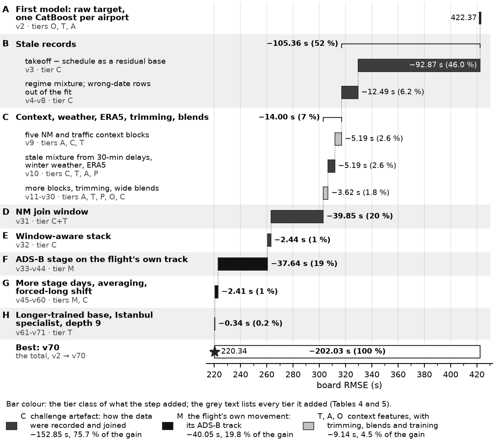

# PRC Data Challenge 2026: departure taxi-out time at ten European airports

This is Team **adventurous-radio**´s contribution to the [PRC Data Challenge 2026](https://prc-data-challenge-2026.netlify.app/), predicting taxi-out times for 10
European airports based on a year of flight and taxi-time data. 
This repository holds the code, configurations, tests and documentation of two model families: the scored **post-operations analysis model** (the
code calls it the challenge model) and the **operational models** for planning. [docs/report.md](docs/report.md).

## Short Summary

Our approach looked at 2 specific use cases for developing the prediction models for taxi-out times:

- **Part 1: the post-operations analysis model** estimates each departure's taxi-out after the flight from everything
  recorded about it: the actual takeoff, NM's flight data and its join to the movements, the flight's own ADS-B track.
  Every feature and technique was kept or dropped by its measured effect on the score. The three large gains came from
  the stale and wrong-date records (defects the score rewards reproducing and a post-operations analysis would flag),
  from the NM join window (an artefact of how the data set was assembled) and from the flight's own track.
- **Part 2: the operational models** predict before the aircraft moves, from data an airport has at that moment, and
  are not scored: one model per decision horizon, each input documented with the system that would supply it.

The reason for this two-part approach was mostly, that we consider the prediction of taxi-out times important not just for post-analysis, but also something that is useful at different time horizons before takeoff or off-block. The post-analysis model (or challenge model) is really the one specifically important for the leaderboard scoring, as it can rely on more data points and produces the best scores. However, the operational models are useful for a variety of operational use cases, to predict the taxi time, possible congestions or delays before actual off-block, even though their score underperforms the post-analysis model due to fewer data points available. See [report.md](docs/report.md) for a more detailled overview.

## Final Challenge Results

Best board score: RMSE **220.34** s, upload v70 (our uploads are numbered v2, v3, ...; its lineage is in
[docs/submission_manifest.md](docs/submission_manifest.md)). The final submission is v70's recipe on the organisers'
final release (run `2026-10-11T03-22-21__final_v70_5c8bf3__5c8bf33e`, sha1 `6cdf67a406177e819e083847fab7c48febc41854`);
its January and July rows scored 220.39 on the board (v73).

## Main findings

This is a very brief overview of our main findings, on what features or corrections reduced the model error. More details here: [report.md](docs/report.md)

### The post-operations analysis model

The board RMSE fell from 422.37 at the first upload (v2) to 220.34 (v70), by 202.03 s. Three findings made 90 % of it:
1. **Stale records, −105.36 s (52 %).** For some departures, mostly at Rome, the airport logged the scheduled
   off-block instead of the push, so the "taxi time" is the departure delay, up to 36 h. Takeoff minus schedule as a
   residual base gained 92.87 s (v3), the wrong-date records taken out of the fit 10.95 s (v6). A regime mixture
   hedges each record between a taxi, the schedule and a wrong date, because the board scores the records as they
   are. For analysis, its stale probability `p_stale` flags the defects; its regressor `y_reg` estimates the taxi time.
2. **The Network Manager join window, −39.85 s (20 %).** The organisers attached the Network Manager's (NM) flight-plan data to an airport record only when the airport's off-block time lay within about one hour (3,606 s) of the flight plan's last off-block time (LOBT). Since the taxi-out is the takeoff minus the off-block, and both the takeoff and the LOBT are published, every matched taxi-out must lie within 3,606 s of takeoff − LOBT. Moving our predictions into that window can only reduce the error: it took the board from 303.02 to 263.17 without retraining (v29 → v31). Most of the gain came from one Rome flight whose flight plan lay a day before its takeoff, so the window forced a taxi-out of at least 23 hours, where we had predicted 28 minutes. The window comes from how the data set was assembled, not from the airports, and this kind of assembled data exists only after the takeoff.
3. **The flight's own ADS-B track, −37.64 s (19 %).** adsb.lol tracks of the flight's own pushback and taxi feed a
   second CatBoost stage, which corrects about 70 % of the 2026 departures.
- **The late plateau.** After v44, 25 uploads gained 2.75 s (1.4 %). The last ten (longer training, depth-9 retrains,
  an Istanbul partner-runway specialist) moved the best score by 0.34 s, on a board whose own noise is about ±0.03 s.
- **For analysis after the fact, not for planning.** Of the 58 inputs that reach the scored file, 7 exist before the
  off-block as computed, 7 once re-anchored on the planned off-block, and 44 not before the aircraft moves, the three
  findings among them. After the flight the 44 inputs are no obstacle; before it they rule the model out.
- **What the 2025 data records hold.** 584 targets above two hours (480 at Rome), 438 of them the schedule logged as the
  off-block, and 15 records on the wrong date: on v70's holdout dataset the targets above one hour, 0.28 % of the rows, carry
  59.6 % of the squared error. On the strongest day of 2025 at Istanbul and Munich (snow), Rome (thunderstorm) and
  Paris (freezing fog), the mean taxi-out was 2.0-2.8 times the airport's median day (docs/report.md section 1.4).



*The board RMSE by stage, from v2 (422.37) to v70 (220.34), coloured by what each step added: challenge artefacts of
how the data were recorded and joined, the flight's own movement, or context features with trimming, blends and longer
training (docs/report.md Figure 2; every upload in its Figure 1, every step in its Table 4).*

### The operational models: before the aircraft moves

One global CatBoost per decision moment, fitted on 2025, reads only what exists then: 24 h and 3 h before the scheduled
off-block (runway-blind) and H1, 15 min before the last filed off-block, when an A-CDM airport sets its variable taxi
time. Since 13 October the H1 model is F1 (`op_h1_f1_plan`), which also reads the other flights' plans for the next
hour: −2.39 s of OP MAE [−2.73, −2.06] against its predecessor, better in all 10 validation months, −4.79 s forward.
At H1 the file adds a median (rule M: a model fitted on the absolute error) and a P10-P90 band (rule C), both rules
fixed before their runs.

| window | model, output | OP MAE (s) | OP RMSE (s) | all-row RMSE (s) | within ±2 min | board |
|---|---|---|---|---|---|---|
| 24 h before the schedule | `op_hl24_r3_rwyblind`, mean | 218.2 | 321.6 | 611.0 | 40.1 % | 596.10 (v77) |
| 3 h before the schedule | `op_hl3_r4_rwyblind`, mean | 214.5 | 312.8 | 606.2 | 40.2 % | 589.09 (v76) |
| H1 | F1, mean | 184.3 | 276.3 | 583.5 | 47.4 % | 559.77 (v82) |
| H1 | F1, median (rule M) | **178.8** | 281.1 | 594.3 | **50.9 %** | 573.55 (v84) |
| for scale | stand × runway median table (the A-CDM practice) | 207.4 | 330.2 | 636.1 | 45.5 % | – |
| post-operations, after the flight | base member without ADS-B (C1, exp066) | 137.1 | 203.2 | 314.0 | 58.7 % | – |
| post-operations, after the flight | v70, with the flight's own ADS-B track | 103.8 | 174.5 | 294.1 | 71.6 % | 220.34 (v70) |

Holdout: January and July 2025. OP: the NM-matched departures with a target below 1 h (338,277 of 344,419, 98.2 %),
without the long stale and wrong-date records. ±2 min: the A-CDM tolerance. Board: RMSE over all January and July 2026
departures. H0 (2025 lab, at the off-block): 178.2 s. Full table: docs/report.md Table 10.
- **At H1, better than current practice and worse than the post-operations model on every measure:** H1's mean has
  1.34 times C1's MAE. Hours ahead, without the runway, the models trail the table by 7-11 s of MAE but beat its OP
  RMSE. The board measures the records: the 1.8 % of holdout departures outside OP carry 78 % of H1's squared error.
- **What each source is worth at H1.** The flight's own record, stand, runway and calendar reach 196.0 s. All else
  known 15 min ahead adds 8.4 s of MAE and 23 s of RMSE: NM's readings −3.3 s, weather −2.5 s (RMSE −13 s), others'
  records −1.9 s, layout −0.7 s. The planned runway is worth 17.4 s, about 22 s hours ahead. The traffic during the own
  taxi, read by many published models, halves the best push-time error (85.1 against 171.4 s): hindsight, not skill.
- **What each horizon can read.** Hours ahead: the schedule, the flight's plan and stand plan, the layout, the TAF and
  the last METAR, and at 3 h NM's record of the flights already departed. H1 adds the airport's state: the other
  flights' movements so far, NM's readings, the planned runway, the next hour's filed plans (each with its operational
  source: docs/report.md Table 9b). Public ADS-B, a stand-in for surface surveillance (A-SMGCS), is incomplete (none at
  Istanbul, little at Paris) and gained nothing at H1 (+0.05 s), so no deliverable reads it.
- **Out of time, and on the final set.** Each 2025 month scores 156.6-187.6 s at H1, the forward check 173.4 s. On the
  final set (targets withheld), H1's monthly means lie 17.4 s above EUROCONTROL's published ones on average; their
  change from 2025 correlates with EUROCONTROL's at 0.85. The band covers 77.7 % of holdout OP departures.
- **Planning data after the moment** (tier F, upper bounds): `h1f` adds the others' realised arrivals (183.6 s, board
  557.53), F5 all their movements and ADS-B picture (177.4 s, board 551.52). Delivered beside the deliverable, never
  instead of it, they close at most 10 s of the 50-80 s gap to the post-operations models.

## Documentation

| document, in [docs/](docs/) | what it holds |
|---|---|
| [report.md](docs/report.md) | Start here. The main report: Part 1 the post-operations analysis model (data, feature ladder, impact, limits), Part 2 the operational models (horizons, data, scores, files). |
| [DEVELOPER_GUIDE.md](docs/DEVELOPER_GUIDE.md) | The architecture, the leakage guarantees, how to extend the code, where to continue; Appendix A is the harness reference. |
| [QUICKSTART.md](docs/QUICKSTART.md) | From a clean clone to every file: path A one post-operations model, B the operational models, C v70 from scratch, D the final files. |
| [operational_model.md](docs/operational_model.md), [operational_manifest.json](docs/operational_manifest.json) | The operational models' model card (moments, results, information contract, limits, rules, files); the delivered files' sha1s and source runs. |
| [operational_features.md](docs/operational_features.md), [operational_ladder.md](docs/operational_ladder.md) | Every operational input with its definition, source, availability, tier and rationale; every operational run's holdout read-out with the paired steps (both generated, csv files beside them). |
| [submission_manifest.md](docs/submission_manifest.md) | The lineage of v70: its 50 trained runs, every weight, seed and command (generated). |
| [feature_table.md](docs/feature_table.md) | The post-operations model's feature blocks and the availability tier of every input (generated). |
| [findings.md](docs/findings.md) | The lab notebook, kept as written during development: every measurement and decision with its run id, cited as "findings 10.37". It also names development files and local run records that this repository does not hold. |
| [data_sources.md](docs/data_sources.md) | Every data source with its use, licence, required attribution and download. |
| [snow/SYNTHESIS.md](docs/snow/SYNTHESIS.md) | The snow and extreme-weather days of 2025 at the ten airports. |
| [board_history.csv](docs/board_history.csv), [op_runway_knowability.txt](docs/op_runway_knowability.txt) | Every upload with its run and board score; how often the departure runway is knowable at each decision moment. |

## Quick start

```powershell
git clone https://github.com/wurzelDeveloper/prc2026-taxiout-prediction.git
cd prc2026-taxiout-prediction
py -3.13 -m venv .venv                        # bash: python3.13 -m venv .venv && source .venv/bin/activate
.\.venv\Scripts\Activate.ps1
python -m pip install -r requirements.txt
python -m prc --help                          # 18 subcommands
python -m pytest -q tests/test_pipeline.py    # seconds; no data, no network
```

Then put the organisers' twelve 2025 training files, `ranking.parquet` and `submitting.parquet` into
`data/competition_files/` and run `python -m prc prepare`. [docs/QUICKSTART.md](docs/QUICKSTART.md) lists the external
downloads (`prc fetch-*`, section 3) and four paths: A, one post-operations model (about 2 h of GPU); B, the
operational models; C, v70 from scratch (about 69 h of GPU); D, the final files from trained runs (about 4 h of CPU
after the refits). Developed on Windows 11 with Python 3.13 and CatBoost 1.2 on an RTX 4070 Laptop GPU (without a GPU:
docs/QUICKSTART.md section 8).

## Repository layout

```
prc/          the package, run as python -m prc <command>: target masking, feature blocks, training, data fetchers
configs/      base.yaml, one YAML per experiment (exp001-exp076) and per operational model (op_*.yaml)
lab/          the post-operations model's ADS-B stage (lab/ideas/ holds its table builders), post-processing and
              final-set replay; the operational models' rules and delivery; lab/README.md lists the scripts
tests/        pytest; most files need neither the data nor the network
notebooks/    04 training-data statistics, 07 the operational models, 08 the report's figures; build/ makes them
docs/         the documentation, its generated tables and manifests, figures/ and snow/
data/, data_*/, cache/, runs/, submissions/   local data and outputs; gitignored
```

[lab/README.md](lab/README.md) lists every lab script, what it does and how it is run.

## Data sources and attribution

No data is distributed with this repository: the organisers' files come from the challenge, every external source is
fetched by a `prc fetch-*` command into the gitignored `data/` ([licences and notices](docs/data_sources.md)).

| command | source | licence |
|---|---|---|
| `fetch-weather` | METAR: Iowa Environmental Mesonet (Iowa State University); TAF: [Ogimet](https://www.ogimet.com/) | IEM: public-domain statement; TAF: no open licence (operational models only) |
| `fetch-geometry` | stands, taxiways, runways: OpenStreetMap (Overpass API); runway ends: OurAirports | OSM: ODbL 1.0, © OpenStreetMap contributors (<https://www.openstreetmap.org/copyright>); OurAirports: public domain |
| `fetch-era5` | ERA5 / ERA5-Land reanalysis via the Open-Meteo archive API | CC BY 4.0, [Weather data by Open-Meteo.com](https://open-meteo.com/); contains modified Copernicus Climate Change Service information 2026 |
| `fetch-pru` | EUROCONTROL Performance Review Unit open CSVs (a level check of the final files) | source: EUROCONTROL; non-commercial use |
| `fetch-adsb` | adsb.lol globe history: ADS-B positions near the ten airports | ODbL 1.0 |

For the figures derived from adsb.lol and OpenStreetMap data: contains information from adsb.lol contributors and
OpenStreetMap contributors, available under the ODbL (<https://opendatacommons.org/licenses/odbl/1-0/>).

## AI Disclamer
This work was developed collaboratively with Claude Code, using the models Claude Opus 5.5 and Claude Fable 5.1 for coding and documentation. Architectural decisions and decisions about the approach to the challenge (feature selection, operational interpretation of the data etc.) were responsibility of a human.

## Licence

The code, the documentation and the figures are licensed under the GNU General Public License, version 3 or any later version (`GPL-3.0-or-later`), WITHOUT ANY WARRANTY; the
full text is in [LICENSE](LICENSE). It covers this repository's own work, not the data: each source keeps its licence.

