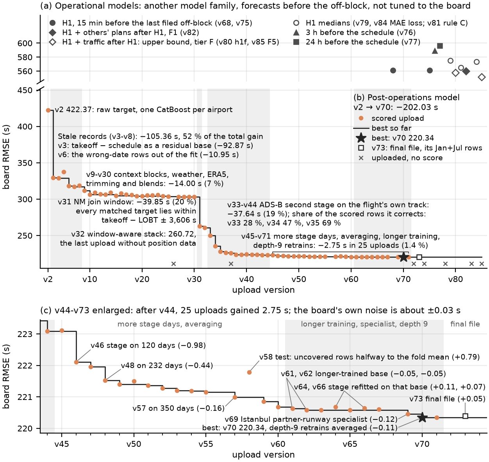
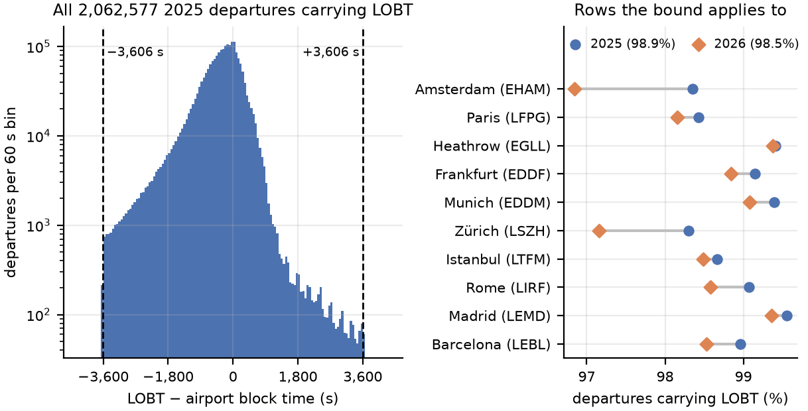
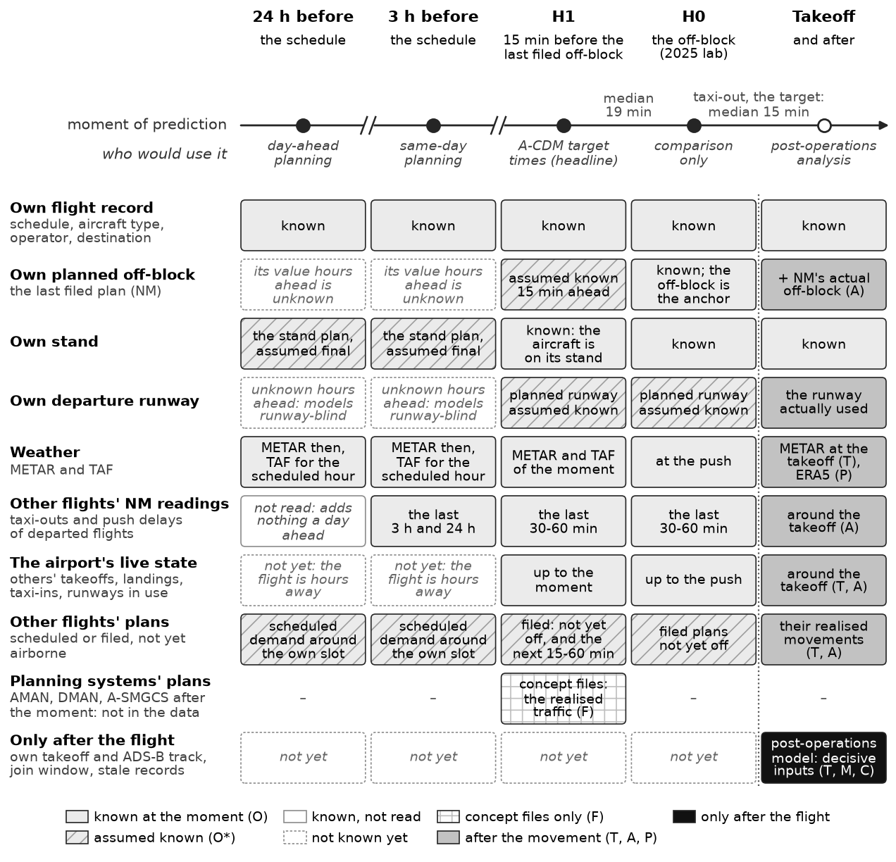
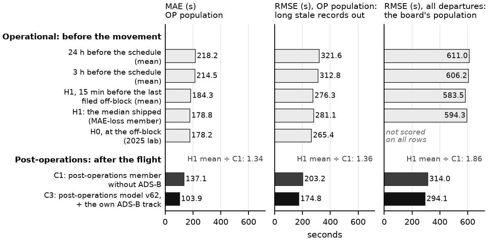

# Departure taxi-out time at ten European airports: a post-operations analysis model and an operational model family

*PRC Data Challenge 2026 · team adventurous-radio · main report, 14 October 2026*

## Summary

The PRC Data Challenge 2026 asks for the taxi-out time of every departure at ten European airports, scored by the root
mean square error (RMSE). Our central finding is that the score depends less on the airports' operations than on how the
records were made. A few defective records, where the airport logged the scheduled off-block time (SOBT) as the actual
off-block or put the block time on the wrong date, carry most of the squared error: on the 2025 holdout, the targets
above one hour are 0.28 % of the departures and 59.6 % of the scored model's squared error. And the tolerance used to
join the Network Manager's (NM) flight list to the movement records places every matched target inside a known interval.

**The post-operations analysis model** is our scored model. It reads what data exists after the flight, as a
post-operations analysis does. Its leaderboard RMSE fell from 422.37 s at the first upload to 220.34 s (v70). Three
findings made 90 % of that gain: modelling the records where the airport logged the SOBT instead of the actual
off-block, the *stale* records (−105 s), the interval implied by the NM join tolerance (−40 s; first found in the public
code of the teams merry-quicksand, zestful-fountain and kind-mango, section 1.4) and ADS-B observations of the flight's
own pushback and taxi (−38 s). The last uploads, with longer training, moved the score by tenths of a second. The data
also hold disrupted days on which an airport's mean taxi-out doubled or nearly tripled, from snow, freezing fog or
thunderstorms (Table 6).

**The operational models** serve planning, which the post-operations model cannot: 44 of its 58 inputs exist only after
the aircraft moves. They read only what is known 24 h and 3 h before the scheduled off-block, or 15 minutes before the
last filed off-block. On the 2025 holdout without the long stale and wrong-date records, their mean absolute error (MAE)
is 218 s, 214 s and 184 s. Fifteen minutes ahead, the model's median prediction, its MAE-optimised output, reaches an
MAE of 179 s and puts 51 % of the departures within ±2 min, against 207 s and 46 % for a stand × runway median table
computed from the 2025 data, the simplest form of the static variable taxi time tables that Airport Collaborative
Decision Making (A-CDM) airports use; the post-operations model reaches 104 s. The operational models are less accurate
on every measure, because they answer a different question: how long the taxi from the stand to takeoff will take, asked
before the aircraft leaves the stand. For 2026 the true taxi-out times are withheld, but EUROCONTROL publishes each
airport's average taxi-out per month. Our 15-minute model's monthly averages come out 17 s higher than EUROCONTROL's, on
average, and they largely reproduce which airport-months became slower or faster than a year earlier (correlation 0.85).

## How to read this report

- **Part 1** is the scored post-operations analysis model: the data (1.1), the ladder of steps with their leaderboard
  scores (1.2), the impact of each feature group (1.3) and what the records revealed and the limits (1.4). Its best
  board score is 220.34 (v70).
- **Part 2** is the operational models, the planning models: the prediction windows and the data available at each
  (2.1), their scores beside the post-operations model's on the same rows (2.2), why they score worse and what they are
  for (2.3), the planning data after the moment of prediction (2.4) and the delivered files (2.5). Without the long
  stale and the wrong-date records their MAE runs from 218.2 s a day ahead to 184.3 s 15 minutes ahead (178.8 s for the
  median prediction); the board gives them an RMSE of 559.8 to 596.1 s.
- Behind this report:
  - [operational_model.md](operational_model.md): the operational models' model card;
  - [operational_features.md](operational_features.md): every operational input with its source, availability and
    rationale;
  - [operational_ladder.md](operational_ladder.md): every operational run's holdout read-out, with the paired steps;
  - [findings.md](findings.md): the lab notebook, kept as written during development, every measurement with its run id
    (cited here as "findings 10.3"); it also names development files and local run records that this repository does not
    hold;
  - [submission_manifest.md](submission_manifest.md): the lineage of v70; [data_sources.md](data_sources.md): the
    sources and their licences;
  - [QUICKSTART.md](QUICKSTART.md): from a clean clone to every file;
  - [DEVELOPER_GUIDE.md](DEVELOPER_GUIDE.md): the architecture and the points where other developers can continue.

**Terminology**
- *Post-operations analysis*: the analysis of operations after the fact, the use the challenge's rationale names. The
  scored model, the *post-operations analysis model*, is built for it; the code and the configurations call it the
  challenge model.
- *Board*: the public leaderboard's RMSE over the 344,841 departures of January and July 2026; v2, v3, … are our upload
  numbers.
- *Holdout*: January and July 2025 (344,419 departures), each model fitted on the other ten months of 2025. It is
  reported in three variants: on all rows; on all rows except the seven wrong-date records (*ex-wd*); and on the *bulk*,
  the targets below 1 h. The operational models are also validated on the *month pairs*, five more holdouts of two
  months each (February and December, March and November, April and October, May and September, June and August), each
  fitted on the other ten months, and on the *forward check*, fitted on January to October and validated on November and
  December.
- *OP population*: the NM-matched holdout departures with a target below 1 h (338,277, 98.2 %), where the operational
  models are scored. RMSE on it is the RMSE without the long stale records and the wrong-date records; stale records
  from shorter delays stay in (2.2). It differs from the bulk only in also requiring an NM match.
- *Windows*: the operational models predict 24 h and 3 h before the scheduled off-block, and at *H1*, 15 minutes before
  the flight's last filed off-block; *H0* is a lab model at the recorded off-block, scored on 2025 only (2.1). H1 and H0
  are this project's labels, not A-CDM milestones.
- *Rules*: decisions written into findings.md before the runs they judge, and computed by a script from holdout
  predictions (findings 10.35-10.37). *Rule C*, the median rule: a median and a P10-P90 band, calibrated on the month
  pairs, ship only if the median beats the mean by at least 1 s of MAE and 1 percentage point within ±2 min, no airport
  gets more than 2 s worse and the band covers 75-85 % of the departures. *Rule M*, the MAE rule: a model fitted on the
  absolute error replaces that median only if it beats it again by 1 s and 1 percentage point. *Rule F*, the forward
  tripwire: November or December of the forward check more than 8 s worse than in the month pairs. *Rule T*, the
  traffic-credit rule: the conditions under which a gain from the other flights' traffic after the prediction moment may
  be credited to planning data rather than to traces of the flight's own movement (2.4). *Rule R*: whether the 3 h and
  24 h models read NM's readings of the flights already departed; the 3 h model keeps them, the 24 h model drops them
  ([operational_model.md](operational_model.md)).
- *Model names*: *H1-base* is the H1 model until 13 October (`op_h1_r4_nodoy`; board v75); its predecessor, which still
  read the day of the year (`op_h1_r4`, v68), appears only in the oracle check of sections 1.4 and 2.3. *F1*
  (`op_h1_f1_plan`), H1-base plus the other flights' filed plans for the next hour, is the H1 deliverable since 13
  October; `h1f` and *F5* are the two concept files (2.4). *C1*, *C2* and *C3* are the post-operations reference models
  of section 2.2.
- *Letters*: one letter can belong to four families, so the word in front says which: *tier C* (when an input exists),
  *stage C* (a stage of the ladder, Table 4), *rule C* (a decision rule) and *reference model C1*. A tier letter is
  never written alone. The "F" in the names F1 and F5 is not tier F: F1 reads tier O and O* inputs only; only `h1f` and
  F5 read tier F inputs.
- *Off-block, push*: the moment the aircraft leaves its stand (A-CDM's AOBT), by pushback or under its own power; the
  words are used interchangeably here.
- *SOBT*: the scheduled off-block time (`SCHED_TIME_UTC_mvt`); "takeoff − schedule" below means takeoff minus SOBT.
- *NM's clocks*: NM's time stamps LOBT, IOBT, EOBT_1 and AOBT_3 (1.1).
- *Pier*: the stand group, taken from the leading letters or the numbering block of the stand identifier, per airport.
- *Stand × runway table*: a median per stand and runway computed from the 2025 training months, the simplest form of the
  static variable taxi time (VTT) tables A-CDM airports use; it is our baseline for current practice, not a table
  obtained from an airport.
- *Tiers* say when an input exists:

| tier | meaning |
|---|---|
| O | operational: known before this flight's off-block |
| O* | operational under an assumption the data cannot check. The assumptions: the planned runway is the recorded one; the stand plan is final hours ahead; the flight's last filed off-block is known 15 min ahead and the other flights' for the next hour; the other flights' recorded runway and stand are used in place of their planned ones |
| T | computed relative to the flight's actual takeoff time; would be operational if computed relative to a planned time such as the target takeoff time (TTOT) |
| A | after the off-block: the flight's own NM actual off-block (AOBT_3), or other flights' events after the prediction time |
| M | the flight's own movement, seen in ADS-B: exists after the fact (post-operations), never before the movement |
| P | published later: ERA5 reanalysis, EUROCONTROL's daily data |
| C | challenge artefact: the NM join window, stale and wrong-date records, the 'missing' value that aircraft type, operator and similar columns take when the NM join failed |
| F | future traffic: in operations the plans of the arrival, departure and surface managers (AMAN, DMAN, A-SMGCS); here the other flights' realised movements after the prediction moment stand in for those plans, so any gain is an upper bound |

After the flight the data of every tier exist, those of tier P once they are published. Tier C marks properties of how
the challenge's records were made, which another data set would share only if its records were made the same way.

Every number comes from the run records (`runs/` and `submissions/uploads.csv`, kept locally and not published)
or from the document cited beside it. Where an older document says otherwise, Appendix A lists the difference;
the run records win.

## Part 1. The post-operations analysis model

**The use.** The challenge's rationale names it: "A model to estimate taxi-out time can be used in post-operations
analysis to identify constrained operations intervals and measure excess fuel burnt/CO2 production compared to
unconstrained status" ([rationale page](https://prc-data-challenge-2026.netlify.app/rationale.html), accessed 14 October
2026). Such an analysis needs the taxi-out of every departure, including departures whose record is missing or
unreliable. After the flight, its actual takeoff, NM's flight data and its own ADS-B track exist; the model reads them
with the ERA5 reanalysis (tiers T, A, M and P), and EUROCONTROL's published data are used to verify its monthly averages
(section 2.3). The model is built for that use; this work did not carry out such an analysis. Two of its three large
gains are properties of how the challenge's records were made (tier C). The stale and wrong-date records are recording
defects, which a post-operations analysis would flag rather than reproduce: the score rewards reproducing them, and the
model's regime mixture (section 1.2) also flags them with its stale probability and estimates their taxi time with its
regressor (section 1.4). The NM join window gives an analyst holding NM's flight data and the takeoff the same bound,
but only where a data set is joined with that tolerance, and it says nothing before the flight.

### 1.1 The data used

The movement records are the data set of the PRC Data Challenge 2026 ([data
page](https://prc-data-challenge-2026.netlify.app/data.html)): every arrival and departure of 2025 at Frankfurt EDDF,
Munich EDDM, London Heathrow EGLL, Amsterdam EHAM, Barcelona LEBL, Madrid LEMD, Paris-Charles de Gaulle LFPG,
Rome-Fiumicino LIRF, Zürich LSZH and Istanbul LTFM, each departure with its taxi-out time as the target, and the 2026
ranking sets with the departures' off-block and taxi times blanked (Table 1). Everything else is published, including
each departure's actual takeoff time and the arrivals' block and taxi-in times.

**Table 1.** The competition data.

| set | departures | months |
|---|---|---|
| training | 2,085,047 | January to December 2025 |
| board ranking set | 344,841 | January and July 2026 |
| final release, the scored set | 670,790 | January, February, June and July 2026 |

**Joined with the NM flight list.** Each record holds two groups of columns: the airport's own fields (`_mvt`: the
times, stand, runway, aircraft type and the target) and the fields of the Network Manager's (NM) flight list (`_flt`:
the flight plan's off-block times, the callsign, a hashed operator and the wake category). The organisers left-joined
the movement table to the NM flight table: every movement keeps its row, and the `_flt` fields are filled only where NM
held a matching flight, which is the case for 98.9 % of the 2025 departures and 98.5 % of the board's. A match exists
only where the airport's recorded off-block lies within 3,606 s of NM's last known off-block time (LOBT); section 1.4
shows that this tolerance places every matched target inside a known interval.

**Table 2.** The data sources and where they are used. Licence texts and download paths are in
[data_sources.md](data_sources.md).

| source | what it provides | post-operations model (scored) | operational models | licence |
|---|---|---|---|---|
| competition movement records (organisers) | every movement: times, schedule, stand, runway, aircraft type; the target | every feature block | the flight's own record and plan; other flights' records up to the moment and their schedules after it (the 24 h and 3 h models' scheduled demand, F1's plans for the next hour) | none stated |
| NM flight list (the `_flt` columns of the same files) | LOBT, IOBT, EOBT_1, AOBT_3, callsign, hashed operator, wake category | NM's clocks, the join window, the stale fingerprint | the H1 anchor and planned delay; the readings of flights already departed; the plan backlog; the other departures' last filed off-blocks for the hour after H1 (F1, O*); never the flight's own actual times | none stated |
| METAR, Iowa Environmental Mesonet | 263,018 reports from 10 stations; no runway-state groups | `wx_now` at takeoff (all 50 trained runs of v70), the de-icing context | every model; a METAR is taken as available 5 min after its observation time | public-domain statement |
| TAF, Ogimet | 28,419 forecasts | not used | every model; an H1 model without TAF scores within seed-to-seed noise, so TAF adds nothing measurable | no open licence (WMO Resolution 40) |
| OpenStreetMap (Overpass) and OurAirports | 5,406 stand objects, the taxiway graph, runway ends; 96.8 % of 2025 departures matched to a stand | `taxi_distance` (48 of the 50 runs); stand positions in the ADS-B stage | stand position; distance and route at H1 | ODbL 1.0; public domain |
| ERA5 / ERA5-Land via Open-Meteo | 140,400 hourly rows: snow depth, snowfall, temperatures, wind | `era5_surface` (all 50 runs) | not used (published after the day) | CC BY 4.0 and the Copernicus licence |
| EUROCONTROL Performance Review Unit (PRU) open CSVs | 6,080 airport-days of delays; 190 airport-months of mean taxi-out | a level check of the final file only | a level check only | non-commercial use, source named |
| adsb.lol globe history | 561 days of position reports near each airport (350 of 2025, 211 of January-July 2026) | the second stage on the flight's own track | no deliverable; the two tier F concept files read it: `h1f` reads three counts of arrivals taxiing in after the moment, F5 (`h1f5`) reads the other aircraft's surface picture after the moment (57 columns, F) and before it (19 columns, O; own-runway hold O*) (section 2.4) | ODbL 1.0 |
| not used | OPDI (insufficient coverage), OpenSky state vectors and Trino (not allowed, by a relayed ruling), 191 dated airport-day events of 2026 (analysis only) | – | – | – |

**The NM fields.** `LOBT_flt` is NM's last known off-block time; it defines the join window (1.4). `IOBT_flt` is by
its name the initial off-block time of the filed plan, but the data hold its last value, without its update time: it
equals LOBT on 99.45 % of the matched 2025 departures and carries most of a late flight's delay (findings 10.35): IOBT
minus schedule has a 90th percentile of 25 minutes. This report therefore calls it the last filed off-block time.
`EOBT_1_flt` differs from LOBT on 30 % of the matched departures and then lies closer to the recorded off-block, like a
late-updated estimate. `AOBT_3_flt` is NM's actual off-block time: takeoff minus AOBT_3 is NM's own reading of the
taxi-out, and the target differs from it with a standard deviation of 384 s (findings 10.3, 10.25).

**What the external data carry.** In the regressor of the submission configuration (exp051), 90.6 % of the split gain
sits in blocks computed from the competition files, 32.9 % in NM's clocks alone; the OSM distance holds 4.4 %, the
METAR 2.4 % and ERA5 2.3 %. Early tests of OSM geometry and of METAR and TAF features were within the seed noise
(holdout 436 and 432 against 430 ± 2; findings 4). ERA5, added for the snow of January 2026, moved the holdout's bulk
by 0.9 s. External data other than ADS-B mattered little for the score.

**The target.** `TAXITIME_SEC_mvt` is the recorded takeoff minus the airport's recorded off-block, exactly, on every
2025 departure (Table 3).

**Table 3.** The 2025 target.

| quantity | value |
|---|---|
| mean / median / standard deviation | 991 / 912 / 546 s |
| p90 / p99 / p99.9 / maximum | 1,471 / 2,339 / 4,501 / 131,167 s (36 h) |
| above 1 h / 2 h / 20,000 s | 4,126 / 584 / 76 |
| above 2 h, by airport | LIRF 480, EGLL 37, LFPG 37, LTFM 21, LSZH 6, EHAM 3; none at the other four |
| stale records | 438 of the 584 targets above 2 h equal takeoff minus schedule within 2 min (507 within 30 min) |
| wrong-date records | 15 (LIRF 13, LFPG 1, LSZH 1), 84,240-88,392 s; one of them is also stale |
| untyped, NM-unmatched segment | 1,507 departures (LIRF 1,487), 630 with a takeoff more than 2 h after the SOBT, 48.9 % stale; 388 in the board set, 624 in the final set |
| share of the target's total squared deviation from its mean | targets above 2 h (0.028 % of the departures): 41.7 %; NM-unmatched departures (1.08 %): 42.2 % |
| holdout, Jan+Jul 2025 | 344,419 departures: 981 above 1 h, 149 above 2 h, 26 above 20,000 s, 7 wrong-date |

**Stale and wrong-date records.** For some departures the airport did not record when the aircraft left its stand but
when it was scheduled to. The recorded taxi time is then the flight's departure delay, up to 36 h. Most such records
sit in the segment of departures with neither an aircraft type nor an NM match; 1,487 of its 1,507 rows are at Rome.
About half of that segment is stale and half is an ordinary taxi after a long delay. Shorter stale records hide among
ordinary delays: about 9 % of Rome's departures 30-120 min late carry the schedule as their off-block (findings 8.2).
A second defect puts the previous day's date on the off-block, so the target is 86,400 s plus a taxi; twelve of the
fifteen sit in the Rome segment. Neither kind is a taxi time. Both are artefacts of how the records were filled
(tier C), and under RMSE they dominate (Table 3, last two rows). [fig04_06](figures/fig04_06_stale_fingerprint.png)
shows the stale fingerprint, the targets on the line target = takeoff − schedule, and the fifteen wrong-date rows.

### 1.2 The feature ladder for the challenge data set

**The model** has three layers:
1. **A base ensemble of CatBoost models** over feature blocks computed from the whole movement stream (26 blocks and 211
   columns in the submission configuration). The departures' off-block and taxi times are blanked in the frame the
   blocks read, so no feature can read the answer. Each member is a regime mixture: a classifier gives the probability p
   that the recorded off-block is in fact the SOBT (stale) or carries the wrong date, a regressor fitted without such
   rows predicts the taxi, and the prediction mixes the regimes' values by their probabilities (p × (takeoff − SOBT) +
   (1 − p) × taxi for the stale regime), the hedge that minimises squared error. The members are validated on the
   holdout and refitted on all twelve months.
2. **Post-processing**: the clip to the NM join window and the refinements built on it (1.4).
3. **An ADS-B second stage** that corrects the departures whose own ground track was received (about 70 % of 2026).

v70 combines 50 trained runs ([submission_manifest.md](submission_manifest.md)). Table 4 is the ladder from the first
baselines to v70; Figure 1 draws every upload.

**Table 4.** The ladder. Each stage carries its change of the best board score and its share of the total gain
(−202.03 s); each step carries its holdout RMSE (all rows / ex-wd / bulk, where recorded) and its board RMSE.

| stage and step | upload | tier added | holdout | board |
|---|---|---|---|---|
| **Stage A. Baselines and the first model, before the board** | | | | |
| median of the target | – | – | 693.6 / 575.1 / 423.5 | – |
| NM's own reading, takeoff − AOBT_3 | – | A | 672.8 | – |
| median per stand and runway | – | O | 636.1 / 504.6 / 331.2 | – |
| CatBoost on the core blocks, log1p target clipped to [60, 7,200] s | – | O, T, A | 535.7-537.3 (three seeds) | – |
| raw target in seconds, no clip | – | | 428.8-432.7 (three seeds) | – |
| one model per airport | – | | 411.2 | – |
| + a cleaning rule for wrong-date targets; refit on all twelve months | v2 | | 426.8 / 303.0 / 229.0 | 422.37 |
| **Stage B. Stale records: −105.36 s, 52 %** | | | | |
| takeoff − schedule as the base value, the trees predicting only the difference from it; the cleaning rule dropped | v3 | C | 349.1 / 277.2 / 228.5 | 329.51 |
| regime mixture (taxi, schedule, wrong date), two seeds | v4 | C | 344.3 / 273.3 / 224.9 | 328.99 |
| wrong-date rows out of the fit, three seeds | v7 | C | 367.6 / 274.8 / 224.5 | 317.01 |
| **Stage C. Context, weather, ERA5, trimming, blends: −14.00 s, 7 %** | | | | |
| five NM and traffic context blocks, three seeds | v9 | A, C, T | 344.4 / 274.8 / 222.2 | 311.83 |
| stale mixture from 30-min delays, winter weather, ERA5 | v10 | C, T, A, P | 337.3 / 268.2 / 217.7 | 306.63 |
| live NM state, de-icing, geometry, stand state, wake queue, stale rates; three seeds | v15 | A, T, P, O, C | 340.6 / 267.0 / 215.7 | 304.85 |
| feature set trimmed by a time-ordered validation, three seeds | v20 | | 325.0 / 263.0 / 214.1 | 304.08 |
| blend of 17 runs | v29 | | 328.1 / 262.6 / 213.1 | 303.02 |
| **Stage D. NM join window: −39.85 s, 20 %** | | | | |
| v29 clipped to the window | v31 | C+T | 312.2 / 260.3 / 213.0 | 263.17 |
| **Stage E. Window-aware stack: −2.44 s, 1 %** | | | | |
| window inside the mixture, a global regressor, in-window estimate, linked-row exclusion (1.4) | v32 | C | 310.3 / 258.0 / 212.4 | 260.72 |
| **Stage F. ADS-B second stage on the flight's own track: −37.64 s, 19 %** | | | | |
| own movement on 28 % of the board's rows | v33 | M | – | 249.83 |
| second version on 47 % of the rows, six-member base | v34 | M | – | 235.52 |
| all 62 holdout days, eleven-run base, 69 % of the rows | v35 | M | 298.0 / 240.2 / 193.2 | 228.20 |
| own stand and stops; pushback detector and three more feature families | v38 | M | 295.9 / 237.5 / 190.0 | 223.75 |
| a second formulation (the taxi time itself), blended at 0.3 | v44 | M | 295.3 / 236.8 / 189.0 | 223.09 |
| **Stage G. More stage days, averaging, forced-long shift: −2.41 s, 1 %** | | | | |
| stage trained on 120 days | v46 | M | 294.9 / 236.3 / 188.5 | 222.11 |
| 232 days, averaged models, forced-long shift (1.4) | v55 | M, C | 294.5 / 235.8 / 188.1 | 221.15 |
| every stage member on 350 days | v60 | M | 294.3 / 235.6 / 187.9 | 220.68 |
| **Stage H. Longer-trained base, Istanbul specialist, depth 9: −0.34 s, 0.2 %** | | | | |
| three base members at half the learning rate and twice the round cap | v62 | | 294.1 / 235.3 / 187.5 | 220.58 |
| Istanbul partner-runway specialist | v69 | T | 294.1 / 235.3 / 187.5 | 220.45 |
| depth-9 retrains averaged with depth 7 | v70 | | 294.1 / 235.2 / 187.3 | **220.34** |
| **Stage I. Final file**: v70's recipe on the final release, its January and July rows | v73 | | as v70 | 220.39 |

Two readings of the table:
- **The holdout and the board can disagree.** Taking the wrong-date rows out of the fit made the holdout worse (v4 → v7:
  344.3 → 367.6 on all rows) and the board better (328.99 → 317.01): 2026 does not repeat 2025's wrong-date records
  (findings 1). From v6 to v30 the board sat 35-42 s above the holdout without wrong-date rows (ex-wd). After the window
  clip the two agreed within 3 s (v31). With the ADS-B stage the board fell 14.9 s below the holdout (v70), because the
  stage corrects 70.4 % of the 2026 rows against 56.5 % of the holdout's.
- **The final file** is v70's recipe applied to the organisers' final release (670,790 departures). Its January and July
  rows scored 220.39 (v73). It was uploaded on 14 October (07:15 UTC) as `adventurous-radio_final.parquet`; the scorer
  accepted all 670,790 rows and returned no score, so its official score is not in our records.

**Figure 1.** Leaderboard RMSE of every upload, by version. (a) The operational models' board checks on a broken axis:
another family, which forecasts before the off-block and was not tuned to the board (551.52 to 596.10; v80 and v85 also
read the traffic after the H1 moment, tier F, an upper bound). (b) The 67 scored uploads of the post-operations model
(v2-v71) and the best score so far (the board ranks a team by its best upload); the star is v70 (220.34), the open
square v73, the final file's January and July rows (220.39). Crosses mark uploads without a score: v26, the first v37
and the first v85 (13 October) hit the daily limit of five; v72, v74, v78 and v83 are the full final file, which the
live scorer cannot score. The grey spans are the stages of Table 4, with their change of the best score and their share
of the total gain. (c) v44-v73 enlarged, with each upload's change against the best score before it; the board's own
noise is about ±0.03 s. Data: [board_history.csv](board_history.csv); notebook `notebooks/08_report.ipynb`.

### 1.3 The impact of each feature group

Figure 2 gives the board change of every stage of Table 4, with the stages B and C split into the steps of Table 5,
coloured by what each step added. Three quarters of the gain came from the challenge's artefacts (how the records were
filled and joined), a fifth from the flight's own movement, and less than a twentieth from the context features
(traffic, NM clocks, weather, layout), most of them computed relative to the actual takeoff or read after the off-block
(tiers T and A), together with the trimming, blends and longer training of Table 4's stages C and H.

**Figure 2.** The board RMSE of the post-operations model from the first upload (v2, 422.37) to the best (v70, 220.34),
by the stages of Table 4, B and C split into the steps of Table 5: bar length is the change of the best score, the label
its change and its share of the total gain (−202.03 s). Bar colour: the tier class of what the step added; tier C,
challenge artefacts of how the data were recorded and joined (−152.85 s, 75.7 %); tier M, the flight's own movement, its
ADS-B track (−40.05 s, 19.8 %); tiers T, A and O, context features (traffic, NM's clocks, weather, layout) with the
trimming, blends and longer training of Table 4's stages C and H (−9.14 s, 4.5 %). Data:
[board_history.csv](board_history.csv); notebook `notebooks/08_report.ipynb`.

Table 5 orders the feature groups by their measured effect. Groups with a board step come first, by the size of the
step. Then come the groups that were in every member and so never made a board step of their own, by their holdout
permutation importance. Board and holdout seconds are not on one scale.

**Table 5.** Impact by feature group. Board: the change between the two uploads named. Holdout: January and July 2025
unless marked winter (February and December 2025) or forward (fit January-October, validate November-December).

| # | feature group (blocks) | what it captures | tier | board (s) | holdout (s) |
|---|---|---|---|---|---|
| | *with a board step* | | | | |
| 1 | stale-record residual base (`stale_schedule`) | takeoff − schedule, added back outside the trees | C | −92.87 (v2 → v3) | all rows 426.8 → 349.1; Rome 1,101 → 779 |
| 2 | ADS-B stage on the own movement (four feature sets, two formulations) | the flight's own first sighting, pushback, taxi start, stops | M | −40.05 (v32 → v60; about 1 s of which comes from changes to the base ensemble) | ex-wd 257.11 → 235.65; bulk 211.99 → 187.66 |
| 3 | NM join-window clip | target within takeoff − LOBT ± 3,606 s | C+T | −39.85 (v29 → v31) | all rows 328.1 → 312.2; ex-wd 262.6 → 260.3 |
| 4 | regime mixture and wrong-date handling | probability of a schedule or wrong-date record | C | −0.52 (v4); −10.95 (v6, wrong-date rows out of the fit) | all rows 349.1 → 344.3; ex-wd 277.2 → 273.3 (v4) |
| 5 | five NM and traffic context blocks (`nm_hour_context`, `taxi_window_counts`, `nm_cross_deltas`, `runway_sequence`, `key_target_stats`) | the hour's NM delays, traffic between NM's off-block and the takeoff, runway sequence | A, C, T | −5.19 (v7 → v9) | ex-wd 274.83 → 274.75 (a tie); winter −7.6 (`nm_hour_context`) |
| 6 | stale mixture from 30-min delays, winter weather, ERA5 | the stale regime for delays of 30-120 min; METAR look-back, de-icing load; snow | C, T, A, P | −5.19 (v9 → v10) | bulk: 30-min mixture 223.49 → 219.68; winter blocks 223.49 → 222.33; ERA5 218.56 → 217.68 |
| 7 | frame-wide counts that drift between years (`flight_number_context`, `traffic_deviation`, others) | a flight number's regularity, the day's traffic against its weekday norm | T, A | +2.91 when added (v13 → v14); removed again | bulk 217.76 → 216.11 (better); a classifier tells 2025 from 2026 rows on these columns with an AUC of 0.80 and 0.74, so they drift |
| 8 | time-position columns (`takeoff_epoch`, day and week of the year) | the late-2025 level, the season | T, O | +2.49 when removed (v10 → v11); kept | bulk 217.69 → 218.78 when removed |
| 9 | window-aware members and stack | the window inside the mixture, in-window estimate, linked-row exclusion | C | −2.44 (v31 → v32) | ex-wd 260.29 → 257.97 |
| 10 | Istanbul partner-runway counts (`partner_runway`, a specialist blended at 0.3) | traffic on the close parallel runway | T | −0.12 (v62 → v69) | ex-wd −0.06 |
| | *in every member, holdout only* | | | | |
| 11 | NM clocks (`nm_deltas`, `nm_cross_deltas`) | takeoff minus AOBT_3, LOBT, IOBT, EOBT_1 and the schedule; NM's clocks against each other | A, C, T, O | – | permutation +114 to +304 (`nm_deltas`; `nm_cross_deltas` +0.1 to +306); gain 33.6 % (`nm_deltas`; 36.5 % with `nm_cross_deltas`); the NM family is worth about 36 s of OP RMSE (winter 40 s) |
| 12 | stale rates (`delay_stale_stats`) | share of records equal to the schedule among flights 30-120 min late, by carrier and pier | C, O | – | permutation +79 to +90; 42 % of the stale classifier's gain |
| 13 | stand and runway identity (`stand_runway_keys`, `stand_runway_frequency`) | stand, runway and their pairing | O | – | permutation +33 to +66 (`stand_runway_keys`; frequency +3 to +7); gain 12.1 % (13.9 % with the frequency block); as a lookup table 636.1 against 693.6 for the global median (all rows) |
| 14 | arrivals' taxi-in anomaly (`arrival_conditions`) | the arrivals' taxi-in against its norm, last 30 min to 6 h | A, T | – | permutation +18 to +19; winter −3.8 ex-wd, −38 on disrupted days |
| 15 | runway queue and sequence (`taxi_window_counts`, `runway_sequence`, `runway_queue`, `wake_queue`) | takeoffs since NM's off-block, position in the sequence, wake separation | A, T | – | permutation +13 to +15 (`taxi_window_counts`), +2.5 to +4.1 (`runway_sequence`), +0.6 to +1.9 (`runway_queue`), −2.1 to −0.4 (`wake_queue`) |
| 16 | live NM picture of the other departures (`nm_hour_context`, `dep_live_state`) | their NM taxi anomaly in the last 30-60 min, per runway and pier | A, T | – | permutation +6 to +11; removal +1.6 ex-wd each (forward); winter ex-wd 234.37 → 230.95 (`dep_live_state`) |
| 17 | turnaround and stand state (`prev_stand_arrival`, `stand_occupancy`) | the stand's last arrival and previous occupant | A, T | – | permutation +6 to +9; removal +1.8 ex-wd (`prev_stand_arrival`, forward) |
| 18 | airport geometry (`taxi_distance`) | the OSM distance from the stand to the runway threshold | O | – | permutation +5 to +13; gain 4.5 %; removal +0.4 ex-wd (forward) |
| 19 | weather and snow (`wx_now`, `era5_surface`, `deicing_context`) | the METAR at takeoff, ERA5 snow and frost, cold-soaked aircraft | T, P, A | (inside v10) | permutation +1 to +3; gain 2.3 % and 2.2 %; 7.7 s of OP RMSE without the NM family, 0.6 s with it (winter 14.0 and 1.0) |
| 20 | load, identity, calendar (`airport_load`, `load_normalised`, `pier_load`, `aircraft_identity`, `operator_presence`, `calendar`) | traffic level; aircraft type and operator; local time | A, T, C, O | – | permutation at most +4 each |

How the holdout column is measured:
- *Permutation*: the rise of the holdout RMSE (all rows, a 200,000-row sample, three repeats) when a block's columns are
  shuffled together, in v70's three depth-9 base members. Rows 11-20 follow the value in the member fitted over all ten
  airports (the global member), as opposed to the per-airport members. For `stale_schedule` the permutation measures
  model mechanics (the block holds the mixture's candidate values), so row 1 cites the step instead.
- *Gain*: the regressor's split-gain share in the window-aware member exp056, a training-side measure.
- *NM family* and *weather*: a 2 × 2 ablation with a LightGBM stand-in on the OP population, three seeds (findings
  10.29). Weather adds little once NM's clocks are in, because they already reflect it.
- *Removal*: the block retrained away.

Two techniques that are not features were as large as any feature: the raw target in seconds instead of a
log-transformed target clipped to [60, 7,200] s (holdout 536 → 430), and one regressor per airport (430 → 411). Both
came before the first upload, so the board never showed them. Measured and left out (findings 4, 10.2, 10.7, 10.10): an
XGBoost regressor (227.2 against 210.0 s on the holdout rows in the taxi regime, neither stale nor wrong-date), cleaning
rules that drop implausible targets from the fit (548.9 against 432.5 on the holdout, because the equivalent implausible
records in 2026 are scored), EUROCONTROL's daily delays (published after the day), weather after the takeoff (hindsight)
and ADS-B as a stale signal.

### 1.4 What the records revealed, and the limits

This section first gives what the 2025 records hold: defective records and disrupted days (Table 6). It then explains
the three large steps of the ladder, which come from the records and from the flight's own movement, not from a better
description of the airport, then the late plateau, then what the model serves and what it cannot.

**The records' defects (2025).** A handful of records set the RMSE:
- 584 of the 2,085,047 departures of 2025 have a target above two hours, 480 of them at Rome. On 438, the target equals
  the takeoff minus the schedule within two minutes: the airport logged the schedule as the off-block, a *stale* record.
- The stale records gather among the 1,507 departures with neither an aircraft type nor an NM match, 1,487 of them at
  Rome.
- 15 records carry the previous day's date: their target is a whole day plus a taxi (13 at Rome).
- On v70's holdout, the targets above one hour are 0.28 % of the rows and carry 59.6 % of the squared error.

Two figures show the long targets by airport and kind ([fig04_05](figures/fig04_05_tail_anatomy.png)) and the stale
fingerprint ([fig04_06](figures/fig04_06_stale_fingerprint.png)).

**Disrupted days (2025).** The records also show when the taxi-out itself leaves its norm. Table 6 gives each airport's
strongest day of 2025, the day whose mean taxi-out rose most above the airport's median daily mean. Snow and freezing
fog caused seven of the ten, thunderstorms the other three. Istanbul's February snow holds five of the ten strongest
airport-days: on 23 February two thirds of its departures needed more than 30 minutes, against 3 % on a median day. Such
days are rare: 15 of the 3,644 airport-days rose by more than 10 minutes. [SYNTHESIS.md](snow/SYNTHESIS.md) analyses the
34 strongest event days: the hourly course, de-icing, the runway configuration, the next day, and how the models fare on
them (findings 10.14, 10.15).

**Table 6.** Each airport's strongest day of 2025: the local day whose mean taxi-out rose most above the airport's
median daily mean. Mean and share above 30 minutes over the departures with a target below 2 h; only days with at least
half the airport's median number of departures; the airport's median-day values in brackets. Cause: the METAR and the
event-day synthesis [docs/snow/SYNTHESIS.md](snow/SYNTHESIS.md). Computed by `lab/report_data_findings.py`.

| airport | day | cause | departures | mean taxi-out | increase | above 30 min |
|---|---|---|---|---|---|---|
| Istanbul LTFM | Sun 23 Feb | snow all day on 8 cm of cover, −5.8 °C | 610 (754) | 2,829 s (1,007 s) | +1,822 s (×2.8) | 65.6 % (2.8 %) |
| Munich EDDM | Wed 24 Dec | snow 05-17 UTC, gusts of 33 kt, holiday schedule | 272 (482) | 1,955 s (791 s) | +1,164 s (×2.5) | 54.0 % (0.3 %) |
| Rome LIRF | Sun 13 Jul | thunderstorms, 10-18 UTC (12-20 local time) | 430 (455) | 2,229 s (1,136 s) | +1,093 s (×2.0) | 56.7 % (6.7 %) |
| Paris LFPG | Fri 17 Jan | freezing fog, low-visibility procedures for 15.5 h | 596 (664) | 1,968 s (1,002 s) | +966 s (×2.0) | 49.3 % (2.1 %) |
| Frankfurt EDDF | Sun 5 Jan | snow, 3.5 cm | 466 (655) | 1,265 s (855 s) | +410 s (×1.5) | 15.7 % (0.5 %) |
| London EGLL | Wed 31 Dec | freezing fog, 09:50-11:20 UTC | 633 (663) | 1,739 s (1,350 s) | +389 s (×1.3) | 29.4 % (9.6 %) |
| Amsterdam EHAM | Sun 5 Jan | snow, the airport's only snow day of 2025 | 573 (690) | 1,113 s (755 s) | +358 s (×1.5) | 15.9 % (0.3 %) |
| Zürich LSZH | Sat 4 Jan | snow, then freezing rain | 307 (375) | 1,074 s (727 s) | +347 s (×1.5) | 16.0 % (0.3 %) |
| Barcelona LEBL | Thu 9 Oct | thunderstorms (the cut-off low "Alice") | 492 (508) | 1,276 s (948 s) | +328 s (×1.3) | 15.0 % (0.7 %) |
| Madrid LEMD | Fri 2 May | thunderstorms with heavy rain | 569 (588) | 1,185 s (1,009 s) | +176 s (×1.2) | 9.1 % (1.4 %) |

**Stale and wrong-date records (stage B, −105.36 s).** The post-operations model predicts these defective values on
purpose, because the score counts them as they are: on the 2025 holdout the seven wrong-date rows carry 36 % of v70's
squared error, the 26 targets above 20,000 s, which include those seven, 47.3 %. The first step added the takeoff minus
the schedule back as a residual base outside the trees, so for a stale row the trees only have to predict zero: v3 took
the board from 422.37 to 329.51, the largest single step of the project. A regime mixture then hedges each candidate row
between a taxi, the schedule and a wrong date; its classifier reaches an AUC of 0.947 on the delayed holdout rows and is
calibrated in every probability band. A probe settled what 2026 holds: trained on data with the wrong dates corrected,
v5 scored 8.36 s worse, which fits only if 2026's Rome rows with a takeoff more than 2 h after the SOBT are stale
records; taking the wrong-date rows out of the fit then gained 10.95 s (v6).

For a post-operations analysis the same mixture is a data-quality tool: its stale probability flags the records whose
recorded taxi-out is an artefact, and its regressor estimates the taxi time those records should have held.

All of this needs the actual takeoff. Before the aircraft moves, the delay to come is unknown: on stale rows the actual
delay exceeds the planned delay plus a taxi by a median 679 s. Whether an airport logs the schedule instead of the
pushback is a recording failure decided after the flight. An oracle that named every stale row and predicted the planned
delay for it would move the all-row holdout RMSE of an earlier H1 model (`op_h1_r4`, v68) only from 585.3 to 582.8 s
(findings 10.31).

**The NM join window (stage D, −39.85 s).** The organisers built each record by joining the airport's movement to NM's
flight list. A movement received NM's data only when the airport's recorded off-block lay within 3,606 s of NM's last
known off-block time (LOBT): a join with a tolerance of about one hour. On all 2,062,577 matched departures of 2025,
LOBT minus the recorded off-block lies between −3,606 and +3,606 s, without exception, and every departure carrying
LOBT is matched (Figure 3). The 2026 ranking set was joined the same way before its off-block times were blanked. The
target is takeoff minus off-block, and both the takeoff and LOBT are published, so every matched target lies in a
known interval:

> **takeoff − LOBT − 3,606 s ≤ target ≤ takeoff − LOBT + 3,606 s**

The bound covers 98.5 % of the board set (339,551 of 344,841 departures). Moving a prediction from outside the interval
to its nearest edge can only shorten its distance to the truth, which lies inside. Clipping v29 changed 164 predictions
(159 raised, 5 lowered) and guaranteed a fall of the board's MSE by at least 20,124 s². It fell by 22,562 s², from
303.02 to 263.17, without retraining anything.

95.8 % of that MSE reduction came from one Rome flight, ITY340 on 17 July 2026, whose NM clocks lay a day before its
takeoff: we had predicted 1,683 s, and its window starts at 83,214 s. Its only 2025 twin (AEZ146R, 87,002 s) was among
the wrong-date rows that our tail metric (ex-wd) leaves out, so that metric could not show what the clip was worth
(findings 10.4).

The window is an artefact of how the data set was assembled, not a property of the airport (tier C+T). It comes from a
database join, it needs the actual takeoff, and it says nothing about a flight that has not yet moved. After the flight,
an analyst holding NM's flight data and the takeoff time has the same bound, but only where a data set is joined with
that tolerance. We did not discover it: our survey of competitors' public repositories found it on 30 September in other
teams' code (merry-quicksand's "M1" rule, zestful-fountain's clock overlay and kind-mango's rule for the ITY340 record;
findings 10.3), and we verified it on our data before using it. The ±12 s jitter the organisers applied to the movement
times of the final release matters little: about 0.03 % of the matched 2025 departures lie within 12 s of an edge
(findings 10.33).

**Figure 3.** The NM join window. Left: LOBT minus the airport's recorded off-block on all 2,062,577 departures of
2025 that carry LOBT; every one lies within ±3,606 s. Right: the share of departures carrying LOBT, the rows the bound
applies to, per airport in 2025 (98.9 %) and in January and July 2026 (98.5 %).

**Built on the window (stages E and G).** Two refinements came with v32. The *in-window estimate* moves a prediction
that the clip raised to the window's lower edge further inside the window, by half the mean amount by which the training
months' targets exceed that edge. The *linked-row exclusion* concerns untyped departures without an NM match whose
arrival record at the destination airport is NM-matched. That record gives the flight's LOBT. Since the departure was
not matched, its true off-block must lie more than 3,606 s from that LOBT, so any regime value that would fall inside
the window is impossible and is ruled out. A third step, the *forced-long shift* (v55), applies where the window's lower
edge already implies a taxi above 30 minutes: it adds the holdout's mean residual in the prediction's band (prediction
minus the window's lower edge), shrunk toward zero and checked by day-level cross-validation; that residual was positive
in every band (findings 10.4, 10.5, 10.20; tier C).

**ADS-B and the flight's own track (stage F, −37.64 s; −40.05 s to v60).** Aircraft broadcast their position, speed and
identity (ADS-B); the open adsb.lol archive keeps what volunteer receivers heard. We linked each departure to an ADS-B
takeoff by its callsign within 600 s of the recorded takeoff, or else to the only unlinked takeoff within 45 s. A second
CatBoost stage then corrects the base prediction from what the flight's own ground track shows: its first sighting, its
pushback (motion against the reported heading), its taxi start and its stops. Where the pushback detector finds a push
(31 % of the linked departures in 2025, 39 % in 2026), the detected push time lies on median 6 s after the recorded
off-block, with a median absolute error of 29 s. The stage took the board from 260.72 to 223.09 (v32 → v44) and, with
more training days, to 220.68 (v60). Once the base changes inside v34 and v35 are netted out, that is about 39 s.

The other aircraft's ADS-B picture added little:
- In a pilot second stage, the airport's surface picture before the off-block made the error worse (248.8 against 247.8
  s on five holdout days, ex-wd), while the own movement took it from 253.0 to 237.8 s on ten.
- The other aircraft's observed taxis, given to the flights the archive did not see, added nothing (224.5 against 224.9
  s).
- In the operational model, the surface picture before the decision moment changed the MAE by +0.05 s over ten
  validation months (findings 10.35).
- Only in combination with the other flights' realised traffic after the H1 moment (tier F, an upper bound; section 2.4)
  did it gain: 1.4 s of OP MAE from their ADS-B picture after the moment and 0.2 s from the picture before it (findings
  10.36).

ADS-B carries no stale signal either (univariate AUC 0.50-0.61, against 0.91-0.95 for the stale classifier). The
stage observes the flight after its off-block (tier M), so it reconstructs the recorded off-block. In operations the
same observation would detect the actual off-block in real time, not predict it. Reception, not the model, sets the
gain (Table 7).

**Table 7.** ADS-B reception and the stage's gain per airport. Linked: departures linked to an ADS-B takeoff in
January and July of each year. RMSE on the holdout rows the stage corrects, without wrong-date rows, before ADS-B and
with v70's stage.

| airport | linked, 2025 / 2026 | RMSE on corrected rows, base → stage | gain |
|---|---|---|---|
| Munich EDDM | 63 / 98 % | 173.2 → 76.6 | 55.8 % |
| Frankfurt EDDF | 97 / 88 % | 172.2 → 102.8 | 40.3 % |
| Amsterdam EHAM | 99 / 98 % | 175.0 → 105.4 | 39.7 % |
| Zürich LSZH | 96 / 96 % | 177.8 → 113.4 | 36.2 % |
| Madrid LEMD | 25 / 89 % | 180.9 → 129.9 | 28.2 % |
| London EGLL | 58 / 96 % | 254.8 → 206.4 | 19.0 % |
| Barcelona LEBL | 98 / 97 % | 213.1 → 177.4 | 16.8 % |
| Paris LFPG | 13 / 40 % | 237.2 → 221.0 | 6.8 % |
| Rome LIRF | 56 / 36 % | 557.0 → 540.3 | 3.0 % |
| Istanbul LTFM | 0 / 0 % | – | – |
| all ten | 57 / 70 % | 242.3 → 200.0 | 17.5 % |

Istanbul and the uncovered Paris rows held 37 % of the projected 2026 error (findings 10.11). On the final set the stage
corrects 468,265 of the 670,790 departures (69.8 %), and adsb.lol has no Rome coverage from late April 2026.

**The late plateau (stages G and H).** After v44, 25 uploads gained 2.75 s, 1.4 % of the total. More training days for
the ADS-B stage paid with halving returns: −0.98 s at 120 days (v46), −0.44 s at 232 (v48), −0.16 s at 350 (v57). On 7
October an analysis found the stage's training data exhausted (the stage held 350 of the 365 days of 2025) and put the
ceiling of further training near −0.15 s. The ten uploads of stage H then moved the best score by 0.34 s, 0.1 % of the
total gain in MSE, on a board whose own noise is about ±0.03 s:
- Three base members at half the learning rate and twice the round cap were each 1.0-2.2 s better alone on the holdout.
  Swapped in, they moved the board by −0.05 s twice (v61, v62); two more such members gave +0.03 s (v67).
- The stage refitted on that base improved the holdout and lost on the board (v64 +0.11 s, v66 +0.07 s).
- Depth-9 retrains tied depth 7 alone and gained 0.11 s averaged with it (v70).
- The Istanbul partner-runway specialist gained 0.12 s (v69).

These retrains cost about 22 h of training. They were chosen on the holdout under acceptance thresholds fixed before
each upload, not by probing the board, and the final pipeline reproduced the score on the re-released, time-jittered
data (220.39 against 220.34). But every selection since September used the same 62 days of January and July 2025, and
late board steps were up to 4.5 times their holdout change (v59). The late work tuned a score whose size rests on the
challenge's artefacts; it did not improve the estimate beyond these records, nor did it make a planning model.

**A post-operations model, not a planning model.** The challenge gives each flight's actual takeoff and hides one time
stamp, the recorded off-block. The model therefore answers a retrospective question, when did this aircraft leave its
stand given what happened afterwards, which is the question post-operations analysis asks. Departure management asks
before the aircraft moves. Of the 58 inputs that reach the scored file, 7 exist before the off-block as computed, 7 once
recomputed relative to the planned off-block, and 44 not before the aircraft moves (findings 10.23,
[feature_table.md](feature_table.md)); the three largest gains are among the 44. A statement relayed by another team and
not verified by us agrees: the organisers called the model "for post-ops, not for tactical use"
([data_sources.md](data_sources.md), section 4). Table 8 puts both families on the same holdout rows.

**Table 8.** The two families on the OP population of the holdout (338,277 departures). v70's row is computed from its
run record (`2026-10-06T10-47-37__dc_A_S79_3289fc__3289fcc3`); the other rows are the ladder's
(`docs/operational_ladder.csv`), whose post-operations reference C3 is v62.

| model | what it reads | OP MAE (s) | OP RMSE (s) | within ±2 min | board |
|---|---|---|---|---|---|
| median per stand and runway (the stand × runway table, our baseline for current practice) | stand, runway | 207.4 | 330.2 | 45.5 % | – |
| H1-base, the H1 model until 13 October, mean of three seeds (`op_h1_r4_nodoy`) | what is known 15 min before the last filed off-block (O, O*) | 186.7 | 278.7 | 46.6 % | 560.98 (v75) |
| operational H1 with the other flights' filed plans (F1, `op_h1_f1_plan`, the H1 deliverable since 13 October) | the same, plus the plans for the next hour (O*) | 184.3 | 276.3 | 47.4 % | 559.77 (v82) |
| post-operations base member without ADS-B (exp066) | the actual takeoff, NM's actual times, other flights' later events, the join window, the record regimes (T, A, C) | 137.1 | 203.2 | 58.7 % | – |
| post-operations model v70 | the same, plus the flight's own ADS-B track (M) | 103.8 | 174.5 | 71.6 % | 220.34 |

The H1 deliverable F1, which reads only what is known 15 minutes before the last filed off-block, reaches 184 s of MAE
(187 s before the other flights' plans were added), against 207 s for the stand × runway table. The post-operations
member without ADS-B reaches 137 s because it reads the actual takeoff, NM's actual off-block and the other flights'
later events; v70 reaches 104 s with the flight's own track. Three hours and a day before the schedule, without the
runway, the operational models score 589.09 and 596.10 on the board (v76, v77). The board gap is mostly record handling:
the 1.8 % of holdout departures outside the OP population carry 78 % of the H1 model's squared error (65 % of v70's).
The operational models are therefore read by MAE and RMSE on the OP population, which leaves out the long stale and the
wrong-date records, beside the RMSE over every departure (Part 2).

For planning, a second model family uses only data available before or at the off-block, each input documented with the
system that would supply it in operations (Part 2). The scored final file is the post-operations model's; the
operational models are delivered beside it and are not scored.

## Part 2. The operational models

The post-operations model answers after the flight has gone. The operational models answer before it moves, each reading
only what exists at its moment. They are the planning models. The
model card is [operational_model.md](operational_model.md), the input catalogue
[operational_features.md](operational_features.md) and the read-out of every run
[operational_ladder.md](operational_ladder.md). Unless another source is named, the scores below come from that ladder
as regenerated on 13 October (`docs/operational_ladder.csv`).

### 2.1 The prediction windows and the data available at each

A taxi-out prediction serves different decisions at different distances from the movement, so there is one model per
moment (Figure 4, Tables 9 and 9b). Each is one global CatBoost model over the ten airports, fitted on 2025 without the
targets above 2 h and without the wrong-date records. Tiers are as under *How to read*.
- **24 h and 3 h before the scheduled off-block**: 24 h ahead for day-ahead (pre-tactical) planning, such as stand and
  resource plans, 3 h ahead for same-day (tactical) planning. Both run on the published schedule, because the data hold
  no time at which a flight plan was filed.
- **H1, 15 minutes before the last filed off-block time** (IOBT, else LOBT, else the SOBT): the headline window. A-CDM
  applies the variable taxi time to the target off-block time (TOBT) at every milestone and commonly issues the target
  start-up approval time (TSAT) about 40 min before the TOBT; 15 minutes before the last filed off-block is our choice
  of the point where the TOBT is firm, within the ±5 min A-CDM requires, and the pre-departure sequence is being built.
  The median actual off-block lies 19.2 min after the H1 moment. Since 13 October the H1 model is F1, H1-base plus the
  other flights' filed plans for the next hour (section 2.4).
- **H0, at the off-block**: a diagnostic model, not a deliverable: the inputs of H1-base read at the push, plus the
  push's delay against the plan and the schedule (2 columns), scored on 2025 only because the 2026 files blank every
  off-block.

No deliverable reads the flight's own takeoff, its NM actual off-block, its own ADS-B track, the NM join window or the
record regimes: the post-operations model's decisive inputs, which exist only after the movement (section 1.4). The
concept files of section 2.4 read the flight's recorded and ADS-B takeoff only to find its airframe and remove it from
the other aircraft's picture.

**Assumptions.** Hours ahead, the runway depends on a configuration not yet chosen. A persistence predictor, the
dominant departure runway of the hour before the moment, matches the recorded runway on only 53.4 % of the 2025
departures at 24 h and 53.3 % at 3 h, against 66.3 % at H1 (`docs/op_runway_knowability.txt`); a tower would know more
from the forecast wind and the preferential runway system, but the data hold no configuration forecast. The 3 h and 24 h
models are therefore runway-blind, and they take the stand plan as final. At H1 the planned runway is assumed to be the
recorded one, the last filed off-block times to be known (the flight's own 15 min ahead, the other flights' for the next
hour), and the other flights' recorded runway and stand to stand in for their planned ones (tier O*). Section 2.3 bounds
what the runway and the plans are worth.

**Table 9.** The prediction windows, with each model's input columns by tier
([operational_features.md](operational_features.md), Part C). Nine columns (aircraft type and wake category, kind of
operation, operator) are tier C only through their 'missing' value, the mark of a record outside the NM join; on the
NM-joined departures where the models are read they carry the aircraft and the operator, and that level is rare (at most
0.23 % of the OP rows).

| window | model | columns: O / O* / C | known at the moment | not known yet |
|---|---|---|---|---|
| 24 h before the schedule | `op_hl24_r3_rwyblind` | 78: 53 / 16 / 9 | schedule and plan record; stand and its position on the layout (O*); the METAR current at the moment, used as persistence, and the TAF for the scheduled hour; scheduled demand around the scheduled off-block (O* per pier) | runway; last filed off-block; the day's traffic and weather |
| 3 h before the schedule | `op_hl3_r4_rwyblind` | 86: 61 / 16 / 9 | as 24 h ahead, plus NM's record of the flights departed in the last 3 h and 24 h | runway; last filed off-block; the airport's state at the push |
| H1 | F1, `op_h1_f1_plan` | 131: 80 / 42 / 9 | plan and record; stand; planned runway and last filed off-block (O*); METAR and TAF; other flights' movements and NM readings so far; the backlog not yet airborne (O*); other flights' plans for the next hour (O*) | the off-block; other flights' movements after the moment (tier F, concept files only) |
| H0 (2025 lab) | `op_h0_r4_nodoy` | 118: 80 / 29 / 9 | the inputs of H1-base, read at the push, plus the push's delay against the plan and the schedule | the taxi itself |

**Figure 4.** The prediction windows of one departure (not to scale) and what each moment can read; right of the dotted
line, the post-operations model after the takeoff. Light grey: known (O). Hatched: at least one input of the cell rests
on an assumption (O*). White: known, not read. Dashed: not known yet. Grid: concept files only (F, section 2.4). Mid
grey: after the movement (T, A, P). Black: the post-operations model's decisive inputs (T, M, C). Inputs that read the
own runway (counts, wind components, NM readings per runway) share the runway row's O* and are not marked again. Cells
from `docs/operational_features.csv`; notebook `notebooks/08_report.ipynb`.

**Table 9b.** The data points and where an airport would get them ([operational_features.md](operational_features.md),
Parts A and D). Per window, for the model of that window (at H1 the deliverable F1, at H0 the 2025 lab model): *read*,
with the cell's tier (O* where any of its inputs rests on an assumption; as in Figure 4, the counts, NM readings and
wind components per own runway share the runway row's O*, and Table 9's tier C counts as O); *not known yet*: the value
does not exist at that moment (for the other flights' live state and plans: the state around the flight's own push, as
in Figure 4); *not read*: the model does not read it; *F*: only the concept files `h1f` and F5 read it (section 2.4).
A-CDM times: S scheduled, T target, E estimated, A actual; OBT off-block, SAT start-up approval, TOT takeoff, LDT
landing, IBT in-block. IFPS: NM's Integrated Initial Flight Plan Processing System; NM B2B: NM's business-to-business
web services.

| data point | in this work | in operations | 24 h | 3 h | H1 | H0 |
|---|---|---|---|---|---|---|
| the flight's schedule and plan record: scheduled off-block (SOBT), aircraft type and wake category, operator, kind of operation, destination | movement record (`SCHED_TIME_UTC_mvt`, `AIRCRAFT_TYPE_mvt`, `FLIGHT_mvt`, `ADES_mvt`); NM `_flt` columns | airport operational database (AODB): the seasonal schedule; NM flight plan (IFPS) | read (O) | read (O) | read (O) | read (O) |
| its stand | `STAND_mvt` | stand and resource management system: planned the day before, revised on the day | read (O*): the plan, assumed final | read (O*): the plan, assumed final | read (O): the aircraft is on it | read (O) |
| its planned runway | `RUNWAY_mvt`, the runway used | ATC's assignment in the configuration in use; the DMAN's runway plan | not known yet (runway-blind) | not known yet (runway-blind) | read (O*): the recorded one | read (O*) |
| its last filed off-block | NM `IOBT_flt`, else `LOBT_flt` | NM flight plan (NM B2B flight data); the closest operational analogue is the A-CDM TOBT | not known yet | not known yet | read (O*): the anchor, the planned delay | read (O) |
| its off-block | `BLOCK_TIME_UTC_mvt`, 2025 only (blanked in 2026) | A-CDM AOBT in the AODB | not known yet | not known yet | not known yet | read (O): the anchor; the push's delay against plan and schedule |
| weather observed (METAR) | Iowa Environmental Mesonet archive | MET service: METAR, ATIS | read (O): then, as persistence | read (O): then, as persistence | read (O) | read (O): at the push |
| weather forecast (TAF) | Ogimet archive (no open licence) | MET service: TAF | read (O): for the scheduled hour | read (O): for the scheduled hour | read (O) | read (O) |
| the airport layout: stands, taxiways, runways | OpenStreetMap; OurAirports runway ends | aerodrome chart (AIP); the airport's stand database | read (O*): stand position | read (O*): stand position | read (O*): + distance and route to the runway | read (O*): as H1 |
| other flights' schedule around the own scheduled off-block (±30/60 min) | their `SCHED_TIME_UTC_mvt`, per airport and pier | AODB: the day's schedule | read (O*) | read (O*) | not read | not read |
| other flights' filed plans for the next hour (F1) | the departures' `IOBT_flt` (else `LOBT_flt`, else the schedule) and the arrivals' schedule, 15/30/60 min ahead | A-CDM platform (TOBT); NM B2B flight data; AODB schedule | not known yet | not known yet | read (O*) | not read |
| the backlog: other departures whose filed off-block time has passed but which have not yet taken off | their `IOBT_flt` (else `LOBT_flt`) at or before the moment, without a takeoff yet | A-CDM platform (TOBT); AODB (ATOT) | not known yet | not known yet | read (O*) | read (O*) |
| the airport's live state: other flights' takeoffs, landings, arrivals taxiing, taxi-ins, runways in use, the last in-block at the own stand | movement records (`MVT_TIME_UTC_mvt`; the arrivals' `BLOCK_TIME_UTC_mvt`) | AODB: ATOT, ALDT, AIBT in real time | not known yet: the flight is hours away | not known yet: the flight is hours away | read (O): up to the moment | read (O): up to the push |
| NM's readings of the flights already airborne: taxi-out, push delay | NM `AOBT_3_flt`, with their takeoff | NM B2B flight data, or the AODB's AOBT and ATOT | not read: a day-old history adds nothing (rule R) | read (O): their count, taxi-out and push delay, last 3 h and 24 h | read (O): last 30-60 min | read (O): last 30-60 min |
| the traffic situation on the surface: other aircraft taxiing, holding, pushing | public ADS-B from adsb.lol (volunteer receivers) | surface surveillance: A-SMGCS (multilateration, surface movement radar) | not read | not read | not read (F5: O) | not read |
| the arrival manager's plan after the moment | not in the data: the arrivals' realised landings and in-blocks stand in | AMAN: the landing sequence (ELDT, TLDT) | not read | not read | F: `h1f`, F5 | not read |
| the departure manager's plan after the moment | not in the data: the other departures' realised takeoffs, runway use and NM readings stand in | DMAN: the pre-departure sequence (TSAT, TTOT), the runway plan | not read | not read | F: F5 | not read |
| the surface manager's plan after the moment | not in the data: the other aircraft's realised ADS-B surface events stand in | A-SMGCS planning and routing: pushbacks, routes, taxi times, holding | not read | not read | F: F5; `h1f` the arrivals' taxi-ins only | not read |

**The traffic situation.** The deliverables see the other flights through the airport's and NM's records and plans. The
surface picture (aircraft taxiing, holding, pushing) comes from publicly available ADS-B (adsb.lol), a stand-in for the
airport's surface surveillance (A-SMGCS). It is incomplete: no reception at Istanbul, little at Paris, good reception at
Heathrow only from 2026; because the inputs are enabled per airport from the 2025 reception, they stay blank at all
three airports (findings 10.31). No deliverable reads them: a test model, R6 in the model card, which is H1-base plus
that picture, changed OP MAE by +0.05 s on the month pairs (findings 10.35). Only the concept files do, `h1f` after the
moment (F) and F5 before (O) and after it (F). The other flights' realised traffic after the moment stands in for the
AMAN, DMAN and A-SMGCS plans (tier F, an upper bound).

### 2.2 The scores: MAE, RMSE, and RMSE without the long stale records

Table 10 and Figure 5 score every model on the holdout of Part 1 (January and July 2025). The operational models and the
post-operations reference model C1 are fitted on the other ten months. The reference models C2 and C3 are
post-operations models whose post-processing is tuned on the holdout, and C3's ADS-B stage is cross-fitted by day on it:
they are not like-for-like and, if anything, flattered. Every boosted model stops early on the holdout, which flatters
all of them mildly ([operational_model.md](operational_model.md), section 5). MAE, RMSE and the shares within ±2 and ±5
min are read on OP, the NM-matched departures with a target below one hour (338,277 of 344,419, 98.2 %); ±2 min is the
accuracy target the A-CDM Implementation Manual (EUROCONTROL 2017) gives for taxi times, in a table the manual marks as
tentative. The all-row RMSE covers every departure, as the board does. A deliverable's row averages its seeds, as its
file does; they differ by at most 0.23 s of OP MAE.

**Table 10.** The scores per window, beside the airports' table and the post-operations models on the same rows. Board:
the live leaderboard's RMSE over the January and July 2026 departures.

| window | model and output | OP MAE (s) | OP RMSE (s) | all-row RMSE (s) | within ±2 min | within ±5 min | board |
|---|---|---|---|---|---|---|---|
| 24 h before the schedule | `op_hl24_r3_rwyblind`, mean | 218.2 | 321.6 | 611.0 | 40.1 % | 77.7 % | 596.10 (v77) |
| 3 h before the schedule | `op_hl3_r4_rwyblind`, mean | 214.5 | 312.8 | 606.2 | 40.2 % | 78.0 % | 589.09 (v76) |
| H1 | F1, mean | 184.3 | 276.3 | 583.5 | 47.4 % | 83.4 % | 559.77 (v82) |
| H1 | F1, calibrated median (rule C; replaced by rule M) | 180.8 | 278.8 | 587.5 | 49.7 % | 84.0 % | not uploaded |
| H1 | F1, the file's median: the MAE-loss member (rule M) | **178.8** | 281.1 | 594.3 | **50.9 %** | 84.6 % | 573.55 (v84) |
| H0, at the off-block (2025 lab) | `op_h0_r4_nodoy`, mean, seed 42 | 178.2 | 265.4 | – | 48.5 % | 84.3 % | – |
| for scale | stand × runway median table (our baseline for the A-CDM variable taxi time practice) | 207.4 | 330.2 | 636.1 | 45.5 % | 81.0 % | – |
| post-operations, C1 | base member without ADS-B (exp066) | 137.1 | 203.2 | 314.0 | 58.7 % | 90.5 % | – |
| post-operations, C2 | v32 stack without ADS-B (join-window clip and stack) | 135.1 | 200.8 | 310.3 | 59.4 % | 90.8 % | 260.72 (v32) |
| post-operations, C3 | v62, with the flight's own ADS-B track | 103.9 | 174.8 | 294.1 | 71.5 % | 93.3 % | 220.58 (v62) |

C3 is the ladder's reference, v62; v70 scores 103.8 s and 174.5 s on OP, with 71.6 % within ±2 min (Table 8). H0 has
no all-row score: on a stale or wrong-date record its anchor, the recorded off-block, is not the push.

**How the stale records are handled.** No operational model can reproduce a stale or wrong-date record: before the
movement nobody knows that the airport will log the schedule instead of the push, or how late the flight will leave
(section 1.4). The models are therefore fitted without the targets above 2 h (438 of the 584 are stale) and without the
wrong-date records, and they are scored on OP. OP leaves out every target of an hour or more and the departures without
an NM flight: the long stale records and the wrong-date records, which carry the squared error. It filters on the target
and the NM match, not on a stale label, so the shorter stale records stay in the fit and in OP, for every model alike.
By the post-operations model's own regime labels (C1 marks a departure stale when its target lies within 60 s of takeoff
minus schedule, on a takeoff at least 30 min after the schedule or in the untyped, NM-unmatched segment), 1,621 of the
1,988 stale-labelled holdout departures lie inside OP. They carry 5.7 % of F1's OP squared error (OP RMSE 268.9 s
without them, 276.3 s with them), while 96.3 % of F1's squared error on the stale-labelled rows lies outside OP. OP RMSE
is therefore the RMSE without the long stale records. On all rows, the 1.8 % of departures outside OP carry 78 % of the
H1 model's squared error; without only the seven wrong-date records, H1's RMSE falls from 583.5 to 442.3 s (C1: from
314.0 to 259.3 s).

**Readings.**
- **The nearer the movement, the better.** Paired on the same rows (95 % intervals from resampling whole days of the
  holdout, 62 days), OP MAE changes by −3.7 s from 24 h to 3 h [−6.2, −1.5], −30.2 s from 3 h to H1 [−32.4, −28.0] and
  −8.5 s from H1 to H0 [−9.2, −7.7] (H1-base against its inputs at the push). Most of the step to H1 is the runway,
  worth 17.4 s at H1 (findings 10.35).
- **Each output serves its loss.** At H1 the median member has the best MAE and share within ±2 min but the worst RMSE:
  it lies 39 s below the truth on average, as a median of a right-skewed time must.
- **The post-operations models are better on every metric.** H1's mean has 1.34 times C1's MAE, 1.36 times its OP RMSE
  and 1.86 times its all-row RMSE, where the record artefacts sit. Even H0, which knows the off-block, stays 41 s above
  C1.

**On the live board** (January and July 2026, RMSE over every departure) the means score 596.10 at 24 h (v77), 589.09 at
3 h (v76) and 559.77 at H1 (v82); H1-base scored 560.98 with its mean (v75), and 575.06 and 564.87 with its two medians
(v79, v81). The board keeps the holdout's order of the windows and penalises the medians, as a squared error must.
Because the record artefacts set its value, it confirms the files but cannot measure their operational accuracy. On 14
October F1's median scored 573.55 (v84), and F5's mean 551.52 (v85; its first upload, on 13 October, had hit the daily
limit).

**Figure 5.** The scores per window on the January and July 2025 holdout: MAE and RMSE on OP (left, centre) and RMSE
over every departure, the board's population (right). Light bars: operational models, before the movement; dark bars:
post-operations models, after the flight. Each panel prints the ratio of H1's mean to C1. Data:
`docs/operational_ladder.csv`; notebook `notebooks/08_report.ipynb`.

### 2.3 Why they score worse, and what they are for

**Why they score worse.**
- **They predict before the movement.** The post-operations model knows when the flight took off; the operational models
  must forecast the whole taxi, and 15 minutes before the planned off-block the queue the flight will meet has not yet
  formed. A diagnostic model that adds the traffic during the flight's own taxi to everything known at the push reaches
  an OP MAE of 85.1 s against 171.4 s for the fullest H0 configuration (`op_h0_r5`, everything known at the push; the H0
  row of Table 10, `op_h0_r4_nodoy`, scores 178.2 s): the rest is decided during the taxi (hindsight, not operational).
- **They do without the post-operations model's decisive inputs.** 44 of the 58 inputs of the scored file exist only
  after the aircraft moves, the three largest gains of Part 1 among them (section 1.4).
- **They cannot reproduce the record artefacts.** Even an oracle that named every stale record and predicted the planned
  delay for it would move the all-row RMSE of an earlier H1 model (`op_h1_r4`, v68) only from 585.3 to 582.8 s (findings
  10.31).

**What they are for.** Planning needs the taxi time before the aircraft moves, and only these models give it.
- **When it is needed.** The day before for stand and resource plans, hours before for the day's (tactical) plan, and at
  H1, a median 19 min before the push, for the target takeoff time. The post-operations model answers after the takeoff.
- **From data an airport holds then.** [operational_features.md](operational_features.md) documents every input with the
  system that holds it, its tier and its rationale. Runs without single inputs bound what they are worth, on H1-base:
  the planned runway (O*) 17.4 s, the flight's own filed plan and the plan backlog (O*) 2.2 s, the TAF, whose archive
  has no open licence, nothing measurable (findings 10.35). The other flights' plans for the next hour (O*) are worth
  2.39 s, the step from that model to F1 (section 2.4).
- **Better than current practice at H1.** The stand × runway median table, our baseline for the A-CDM variable taxi time
  practice, scores 207.4 s and 45.5 % within ±2 min; H1's median 178.8 s and 50.9 %. Hours ahead the models are 7-11 s
  worse than the table on MAE and below its share within ±2 min (40 % against 45.5 %), but better on OP RMSE (312.8 and
  321.6 s against 330.2 s). That comparison is not like for like: the table reads the recorded runway, which the 24 h
  and 3 h models cannot know.
- **Across the year (out-of-time validation).** Each month of 2025, predicted by a model fitted on the other ten (the
  month pairs; January and July from the holdout), scores 156.6 s (April) to 187.6 s (January) at H1; February and June,
  the analogues of the final set's new months, score 178.6 and 165.8 s. On the forward check H1 scores 173.4 s on
  November and December (3 h 208.2 s, 24 h 214.8 s), and rule F's tripwire did not trip.
- **Checked on the final set** (Table 11). The 2026 targets are withheld, but EUROCONTROL publishes each airport's
  monthly mean taxi-out. H1's monthly means lie 17.4 s above it on average, and their change from 2025 correlates with
  the PRU's at 0.85: without the 2026 targets the model tells which airport-months became slower or faster. Hours ahead
  the 24 h and 3 h files correlate with the PRU's year-on-year change at only 0.51-0.56; the post-operations model's
  file, which knows every takeoff, reaches 0.91.
- **With its uncertainty.** The H1 file's P10-P90 band, calibrated on the 2025 month pairs alone, covers 77.7 % of the
  holdout's OP departures (76.8-79.0 % per airport), with a median width of 465 s.

**Table 11.** The level check on the final set (`prc levelcheck`), on the 23 airport-months where the PRU's reference
share, the share of the airport-month's departures that its mean covers, is at least 0.9. Elsewhere the PRU's mean is
only a lower bound: its indicator excludes flights de-iced after off-block (the PRU's ATXOT documentation), which are
the slow ones, and the reference share falls mostly where de-icing is frequent. Bias: the predicted monthly mean
(predictions below 2 h) minus the PRU's. Correlation: between the predicted and the PRU's change from the same month
of 2025. Flagged: a bias beyond ±50 s.

| file | mean bias (range) | correlation | flagged |
|---|---|---|---|
| H1, F1 (the deliverable) | +17.4 s (−1 to +83 s) | 0.85 | LIRF July (+83 s) |
| 3 h ahead | +27 s (−56 to +86 s) | 0.56 | July at EHAM (−56 s), LEBL (+61 s), LIRF (+86 s), LTFM (+77 s) |
| 24 h ahead | +25 s (−49 to +92 s) | 0.51 | July at EGLL (+63 s), LIRF (+92 s), LTFM (+77 s) |
| the post-operations model's scored file (its run's `level_check.csv`; findings 10.34) | +9.1 s (−6 to +59 s) | 0.91 | LIRF July (+59 s) |

The two families answer different questions: the post-operations model reconstructs the taxi-out after the fact, for
analysis; the operational models forecast it before it happens, for planning, when a forecast is needed.

### 2.4 Planning data after the moment of prediction

An operational model could know the traffic around the planned off-block on both sides of the moment. At an A-CDM
airport the planning systems hold the traffic after it: the arrival manager (AMAN) the landing sequence, the departure
manager (DMAN) the start-up and takeoff sequence, the surface manager (A-SMGCS) the pushbacks, routes and taxi times.
The challenge data hold none of these plans. H1 was therefore tested with the other flights' plans after the moment
where the data hold them (their filed off-block times, O*, and the arrivals' schedule), and with their realised
movements up to 45 min after it, standing in for the planning systems: tier F, not available as computed, an upper bound
for perfect plans.

**Rule T** was fixed and amended before any run (findings 10.36). On its rows (seed 42; the holdout days from 9 January
on, so that the placebo's week-earlier reads stay inside the data), against H1-base (185.3 s), the plans change OP MAE
by −2.6 s [−3.1, −2.2]; with the realised arrivals, a perfect AMAN, by −4.0 s [−4.4, −3.5]; with all realised movements
(F4) by −10.2 s [−11.2, −9.4], to 175.1 s, as close as knowing the own off-block (H0: 175.5 s). A placebo model that
reads the same traffic variables from one week earlier retains 1.7 s of the gain, so that part reflects seasonality
rather than information about the day. But 6.3 s of F4's gain come from the realised departure side, where the flight's
own takeoff, hold and push leave traces in the others' counts. That side gains most at EGLL, LTFM, LIRF and LEBL
(7.7-12.2 s, against 2.1-5.3 s elsewhere). At EGLL, LEBL and LIRF one runway carries 95-100 % of each hour's departures,
so the flight's own departure leaves its strongest trace there; LTFM (65 %) is not explained by that (findings 10.36).
That part cannot be credited to planning data, so rule T's member, the file `h1f`, leaves it out; it beat H1-base in 10
of 10 validation months and forward (172.6 against 178.1 s). Three traces of the own movement stay in it: the next
arrival at the own stand, the missingness of its ADS-B taxi-in columns, which depends on finding the own ADS-B takeoff
(about 0.15 s of MAE in F4), and, on a mixed-mode runway, the landings on the own runway (findings 10.36).

**F1 adopted.** These plans need no AMAN, DMAN or A-SMGCS: the A-CDM platform already holds the other flights' TOBTs at
H1. F1 became the H1 deliverable after checks fixed before their runs (findings 10.37): −2.39 s of OP MAE [−2.73, −2.06]
and +0.75 percentage points within ±2 min against the model it replaced, better in 10 of 10 validation months and by
4.79 s forward; rule F did not trip, and rules C and M passed again.

**Two concept files** sit beside the deliverable, never instead of it (Table 12): `h1f` (27 more columns than F1, all
tier F) and F5 (`h1f5`; 169 more, 150 of them tier F). F5 reads every realised movement of the other flights after the
moment and the ADS-B picture before it, the most context of any operational model, but not the flight's own takeoff as
an input (its ADS-B blocks read it only to remove the own airframe), its own ADS-B track or the NM join window. Its
departure side carries the traces of the flight's own departure, so its gain is an upper bound even for perfect plans.

**Table 12.** The H1 family on the full holdout (OP), from the plans an airport holds today to the full concept.
Board: January and July 2026. `h1f` and F5: the mean of their two refits' holdout predictions (findings 10.36, 10.37).
The ladder's rows of these configurations are single holdout-only runs at seed 42 (`op_h1_f4_nodepthru` 183.8 /
275.9 / 47.6 % / 582.8; `op_h1_f5_full` 177.6 / 266.4 / 48.9 % / 578.9).

| model | adds after the moment | tier | OP MAE (s) | OP RMSE (s) | within ±2 min | all-row RMSE (s) | board |
|---|---|---|---|---|---|---|---|
| H1-base, the H1 model until 13 October (`op_h1_r4_nodoy`, three seeds) | nothing | O, O* | 186.7 | 278.7 | 46.6 % | 584.5 | 560.98 (v75) |
| F1, the H1 deliverable (`op_h1_f1_plan`, three seeds) | the other flights' plans for the next 15, 30 and 60 min | O* (3 columns O) | 184.3 | 276.3 | 47.4 % | 583.5 | 559.77 (v82) |
| `h1f`, the concept member (`op_h1_f4_nodepthru`, two seeds) | + their realised arrivals | F | 183.6 | 275.4 | 47.6 % | 583.5 | 557.53 (v80) |
| F5, the full concept (`op_h1_f5_full`, two seeds) | + their realised records, NM readings and ADS-B picture; the ADS-B picture before the moment | F (150 columns); the ADS-B picture before the moment O (18), own-runway hold O* (1) | 177.4 | 266.1 | 48.9 % | 578.7 | 551.52 (v85) |
| H0, at the push (2025 lab, seed 42) | the flight's own off-block is known | O at the push | 178.2 | 265.4 | 48.5 % | – | – |
| C1, the post-operations member without ADS-B | – | T, A, C | 137.1 | 203.2 | 58.7 % | 314.0 | – |

F5 is 6.9 s better than F1 and 0.8 s better than H0, and still 40.3 s above C1. The level checks of the concept files on
the final set are close to H1's (`h1f` +16 s, correlation 0.87; F5 +12.1 s, 0.89; LIRF July flagged in both). The other
flights' traffic after the moment closes at most 10 s of the 50-80 s between H1 and the post-operations models, about 4
s of it creditable to plans. The rest of the gap is what the challenge data give after the flight has gone: its takeoff,
NM's actual off-block and, for C3, its own track. Knowing the own off-block alone (H0) still leaves 41 s to C1.

### 2.5 The files delivered

Each file predicts the final set: the 670,790 departures of January, February, June and July 2026, one row per id of the
organisers' final template, in integer seconds, from models refitted on all twelve months of 2025. The operational files
are not scored; the scored file is the post-operations model's, the team's single final submission. `lab/op_deliver.py`
wrote the operational files to `submissions/operational/`, which git ignores;
[operational_manifest.json](operational_manifest.json), the tracked copy of their manifest, records every file's full
sha1 and source runs, and QUICKSTART path B regenerates them.

**Table 13.** The delivered files. Section 6 of [operational_model.md](operational_model.md) gives each file's runs and
level check; [operational_features.md](operational_features.md) gives every input.

| role | file | model | outputs | sha1, first 12 hex characters |
|---|---|---|---|---|
| H1, the deliverable | `h1__2026-10-13T13-54-07__final_op_h1_blend__aa1cd03b__mae.parquet` | F1, three seeds; the median from `op_h1_f1_plan_mae_exact_cpu` | mean, median, P10, P90 | 4153b4ea3196 |
| 3 h ahead | `hl3__2026-10-11T18-09-14__final_op_hl3_blend__4d74dbe5.parquet` | `op_hl3_r4_rwyblind`, two seeds | mean | e2252da943f5 |
| 24 h ahead | `hl24__2026-10-11T18-11-54__final_op_hl24_blend__13b5a89d.parquet` | `op_hl24_r3_rwyblind`, two seeds | mean | a395355fae0f |
| concept file, tier F | `h1f__2026-10-13T05-41-39__final_op_h1f_blend__08a90f35.parquet` | `op_h1_f4_nodepthru`, two seeds | mean | 1cae0824c3bb |
| concept file, tier F | `h1f5__2026-10-13T17-23-14__final_op_h1f5_blend__f7393913.parquet` | `op_h1_f5_full`, two seeds | mean | bac06dfdc0bf |
| the scored file (post-operations model) | `adventurous-radio_final.parquet` (locally `submissions/submitting.parquet`) | v70's recipe on the final release, run `2026-10-11T03-22-21__final_v70_5c8bf3__5c8bf33e` | the taxi-out time | 6cdf67a40617 |

The 3 h and 24 h files hold the mean only: their calibrated median would have made Istanbul 2.2 s worse, beyond the
2 s rule C allows. The H1 file's median is the MAE-loss member's prediction, clamped into the band on 0.79 % of the
rows; over the final set its columns have medians of 960 s (mean), 922 s (median), 723 s (P10) and 1,207 s (P90).
Superseded files stay in the folder and the manifest (`h1_calibrated_median`, `h1_r4_nodoy`,
`h1_r4_nodoy_calibrated_median`). The scored file was uploaded on 14 October at 07:15 UTC as
`adventurous-radio_final.parquet`; the scorer accepted all 670,790 rows (status Succeeded) and returned no score. Its
January and July rows scored 220.39 (v73).

## Appendix A. Where this report differs from other documents

The run records win; the other documents are older or count differently.

| topic | other document | this report (run records) |
|---|---|---|
| untyped, NM-unmatched segment | findings 2.2: 1,487 rows (1,466 at Rome), 627 with a delta above 2 h, 49.8 % stale; DEVELOPER_GUIDE.md Appendix A: 1,487 rows | 1,507 (Rome 1,487), 630, 48.9 %; the 388 rows of the board set agree |
| stale share among Rome's departures 30-120 min late | findings 8.2: 9.1 % | a recomputation gives 8.7 %; the definitions may differ, so this report says "about 9 %" |
| join-window edges | findings 10.3: each airport reaches the edge | all ten airports come within 4 s of the lower edge; only EGLL and LIRF reach +3,606 s; the bound holds without exception |
| join window, board MSE | findings 10.3: −22,564 | −22,562, from the logged four-decimal scores |
| ADS-B share of v70's gain over v32 | findings 10.32: the ADS-B stage about 32 s; base swap, shift and specialist about 8 s | v32 → v60 (the ADS-B stage, its −0.04 s shift included) −40.05 s; v60 → v70 −0.34 s |
| stage training days | run labels 121, 240, 360; findings 10.25 gives the gain per doubling (−1.18, −0.59, −0.26) | 120, 232 and 350 actual days; the upload steps were −0.98, −0.44 and −0.16 |
| the full final file | operational_model.md section 6: "rejected" | uploads.csv: "Failed" (the live scorer's truth covers January and July only); "Rejected" is the status of the daily-limit refusals (v26, the first v37, v85 on 13 October) |
